
<table><tr><td>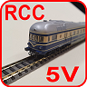</img></td><td>
<h1>RCC-Blocktester 2</h1><b><big>Testsystem für weitere RCC-Komponenten (Steuerblöcke)</big></b>   
Stand: 15.11.2026    &nbsp; &nbsp; &nbsp; &nbsp;
<a href="#TableOfContents">→ Inhaltsverzeichnis</a>&nbsp; &nbsp; &nbsp; &nbsp;
<a href="README.md">→ English version</a>
</td></tr></table>

[Link zur Inhalts&uuml;bersicht](#x05)   

# Worum geht es hier?

Diese Anleitung beschreibt den Aufbau eines zweiten **Testsystems für RCC-Komponenten** (Railroad Control Components).  

Mit dem Testsystem lassen sich folgende Steuerblöcke überprüfen:  

- DCC-Fahrstromerkennung **mit** Schalten des Fahrstroms (TUI)
- DCC-Fahrstromerkennung **ohne** Schalten des Fahrstroms (UI_TVn)
- Pulsflanken-Erkennung 2-fach (PULS1)
- Set-/Reset-Pulsflanken-Erkennung mit Speicherung (PULS2)

Das Testsystem ist bereits vollständig aufgebaut und funktionsfähig. Zum Testen einer neu entwickelten oder neu gebauten Komponente wird diese einfach angeschlossen bzw. eingebaut. Anschließend lässt sich überprüfen, ob alle Funktionen weiterhin korrekt arbeiten.  

Die Frontplatte ist mit 3D-Druck erstellt, sodass die Schaltblöcke leicht ein- und ausgebaut werden können.  

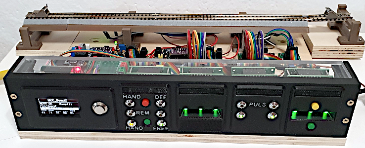

*Bild 1: Ansicht des Blocktesters #2*

Mit einer Größe von **31 × 22,3 cm** ist das Testsystem kompakt genug, um bequem in einer IKEA-SAMLA-Box (Artikelnummer 401.029.78) aufbewahrt zu werden.  

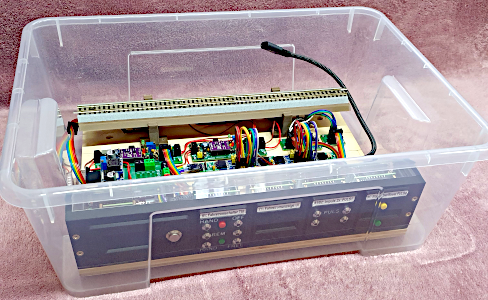

*Bild 2: Blocktester in einer IKEA-Box*

## Eigenschaften des Blocktesters #2
Das folgende Bild zeigt den Blocktester #2 von oben.   

- **Oben:** Gleis mit 3D-Bahnkörper und eingebauten Sensoren (Optokoppler, Reed-Kontakte).  
- **Mitte:** Modulanschluss (Stromversorgung) links, Anschlussplatinen für die Eisenbahnkomponenten und I²C-Platinen.  
- **Unten:** Mikrocontroller mit Shields (links) und die verschiedenen Steuerblöcke daneben.  

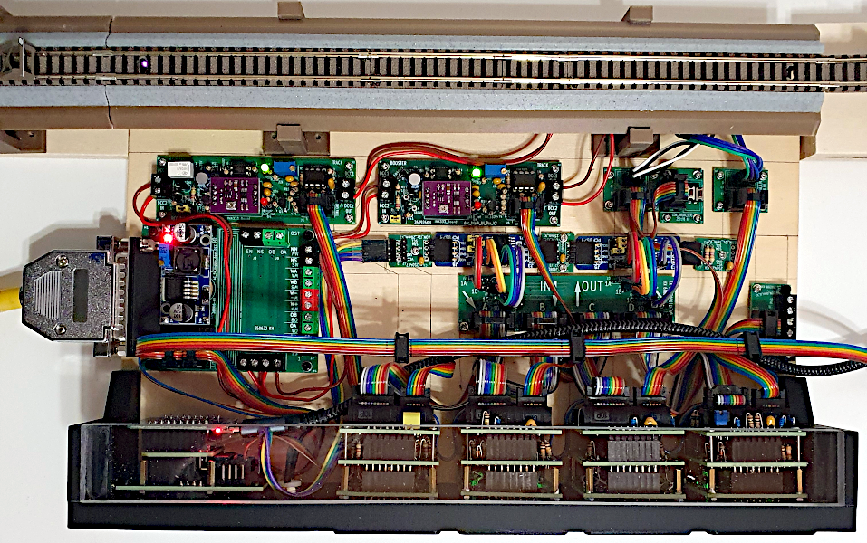   
_Bild 3: Blocktester #2 von oben_   

### &Uuml;bersicht &uuml;ber die System-Eigenschaften 
|                |                                                    |   
| -------------- | -------------------------------------------------- |   
| Modulgröße     | 31 x 22,3 cm², Höhe 7 cm                           |   
| Gleismaterial  | Fleischmann Spur-N-Gleis mit Schotterbett          |   
| Gleisbild      | 2 getrennte Stromkreise, 2x Reed-Kontakt, 2x Optokoppler  |   
| Elektrischer Anschluss | 2x 25-poliger SUB-D-Stecker  (entsprechend NEM 908D, je 1x WEST und OST) |   
| Fahrstrom     | Analog- oder DCC-Betrieb |   
| Steuerung der Schaltkomponenten | * H&auml;ndisch direkt an der Modulvorderseite   * &uuml;ber DCC   * durch MQTT-Nachrichten (&uuml;ber WLAN) |   
| Bedienelemente mit R&uuml;ckmeldung | 1x Mikrocontroller mit OLED-Display und Taster   1x Abschaltbares Gleis mit Fahrstromanzeige (Block TUI, DCC 61)   1x Fahrstromanzeige (Block TU, DCC 71)   1x Impulserkennung (DCC 81, DCC 82)   1x Impulsspeicherung (DCC 91)  |   
| WLAN           | SSID: &nbsp; &nbsp; &nbsp; `Raspi11`   Passwort: `12345678` |   
| MQTT: IP-Adresse des Brokers (Host) | `10.1.1.1` |   
| Sonstiges | * Als Steuersoftware dient die Demo-Software `Demo2` |   

   

# Inhaltsverzeichnis   
* [1. Schaltung des Test-Systems](#x10)   
* [2. Aufbau des Blocktesters #2](#x20)   
* [3. Gleisbau](#x30)   
* [4. Software f&uuml;r den ESP32](#x40)   
* [5. Arbeiten mit dem Blocktester](#x50)   

[Zum Seitenanfang](#up)   
   

# 1. Schaltung des Testsystems
Das Testsystem ist so aufgebaut, dass sich alle Komponenten leicht austauschen lassen. Gleichzeitig zeigt es den Einsatz der verschiedenen Add-on-Platinen.  

Das folgende Bild gibt einen Überblick über die verwendeten Komponenten:  

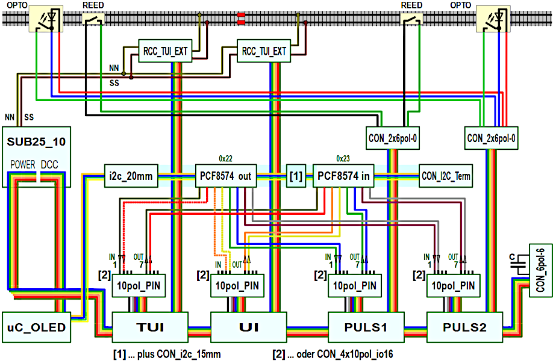   
_Bild 4: &Uuml;bersichtsplan Blocktester #2_   

## Bedeutung der einzelnen Komponenten
Die folgende Liste enth&auml;lt Links zu Beschreibungen und zum Bau der Komponenten.   

`SUB25_10 .....` [Modul-Verbinder mit Netzteil](/fab/rcc1_supply/LIESMICH.md#x30)      
`uC_OLED ......` [Block OLED-Fassung mit I²C- und DCC-Shield sowie ESP32](/fab/rcc2_esp32/LIESMICH.md#x15)   

-------   

`TUI ..........` [Block zum Schalten und Anzeige des Fahrstroms](/fab/rcc4_block/LIESMICH.md#x70), zB zum Erkennen, ob ein Gleis besetzt ist.  
`UI ...........` [Block zur Anzeige eines Fahrstroms](/fab/rcc6_additional_components/LIESMICH.md#x40), zB zum Erkennen, ob ein Gleis besetzt ist.  
`PULS1 ........` [Block zur Anzeige von zwei unabhängigen Impulseingängen](/fab/rcc6_additional_components/LIESMICH.md#x20).  
`PULS2 ........` [Block zur Anzeige eines Set/Reset-Impulseingangs](/fab/rcc6_additional_components/LIESMICH.md#x30).  

-------   

`10pol_PIN.....` Umsetzer vom 10-poligen Flachbandkabel auf 2x4 Pin [als &auml;ltere Version `CON_10pol_PIN`](/fab/rcc5_add_ons/LIESMICH.md#x90) bzw. [als neuere Version `CON_10pol_2x4`](/fab/rcc5_add_ons/LIESMICH.md#x80)   
`CON_2x6pol-0..` [ I²C-Verlängerungsplatine bzw. Umsetzer vom 6-poligen Flachbandkabel auf 6 Pins](/fab/rcc5_add_ons/LIESMICH.md#x70)
`CON_6pol-6 ...` [Umsetzer vom 6-poligen Flachbandkabel auf 6 Schraubklemmen](/fab/rcc5_add_ons/LIESMICH.md#x50).  
`CON_4x10pol_io16 ` [4-fach Umsetzer vom 10-poligen Flachbandkabel auf 2x4 Pin](/fab/rcc5_add_ons/LIESMICH.md#x100) zB als Ersatz von 4 Stück `10pol_PIN`.  

-------   

`i2c_20mm .....` [I²C-Halterung 20 mm](/fab/rcc3_i2c/LIESMICH.md#x20)   
`PCF8574 ......` [I²C-PCF8574-I/O-Platinen](/fab/rcc3_i2c/LIESMICH.md)   
`CON_i2c_Term..` [I²C-Platine mit Pull-up-Widerst&auml;nden](/fab/rcc3_i2c/LIESMICH.md#x60)   
`i2c_15mm .....` [I²C-Halterung 15 mm](/fab/rcc3_i2c/LIESMICH.md#x20)   

-------   

`RCC_TUI_EXT...` Fahrstromerkennung [mit Schalten `RCC_TUI_EXT`](/fab/rcc4_block/LIESMICH.md#x72) und [ohne Schalten `dcc_track_UI_TVn`](/fab/rcc6_additional_components/LIESMICH.md#x42)   

[Zum Seitenanfang](#up)   
   
   

# 2. Aufbau des Blocktesters #2
## 2.1 Rahmen
- **Grundplatte**: Größe 31 x 22 cm², 10 mm-Pappelsperrholz.  
- **Frontplatte**: Größe 31 x 6 cm², 10 mm-Pappelsperrholz oder [3D-Druck (bt2_frame_front_S_Oled_3456_310mm_261107.FCStd)](./3d/fcstd/bt2_frame_front_S_Oled_3456_310mm_261107.FCStd).  
- **Seitenteile**: Größe 5 x 5 cm², 10 mm-Pappelsperrholz oder [3D-Druck (bt2_side_261107.FCStd)](./3d/fcstd/bt2_side_261107.FCStd).  
- **"Deckplatte"**: Größe 30 x 3 cm², 10 mm dicke [Acrylplatte](https://de.aliexpress.com/item/1005006407038394.html?spm=a2g0o.order_list.order_list_main.506.f9f35c5f0KKSc4&gatewayAdapt=glo2deu). So kann man die Schaltbl&ouml;cke darunter gut sehen.   

   

## 2.2 Frontplatte
__OLED-Anzeige__   
F&uuml;r den OLED-Mikroprozessor-Block wird ein [3D-gedruckter Rahmen (OLED_Mount_250209.3mf)](/fab/3d/LIESMICH.md#x40) verwendet.   

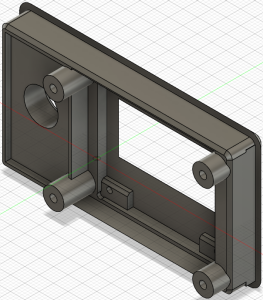   
_Bild 5: Halterung f&uuml;r die OLED-Anzeige und den Taster_   

Dieser ben&ouml;tigt eine rechteckf&ouml;rmige Aussparung der Gr&ouml;&szlig;e 80 x 43 mm². Da der Platz am Frontpanel beengt ist, betr&auml;gt der Abstand vom linken Rand nur 15 mm statt der sonst &uuml;blichen 30 mm.   

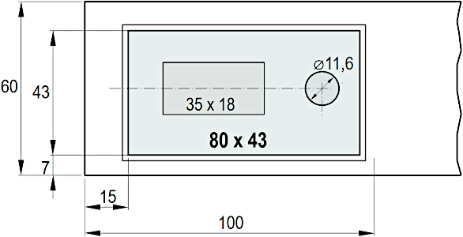   
_Bild 6: Ma&szlig;e f&uuml;r die OLED-Ausnehmung in der Frontplatte_   

__Steuerbl&ouml;cke__   
> Bei _*Holzfrontplatte*_: Zum einfachen Bestimmen der Lage der Bohrungen f&uuml;r die Steuerbl&ouml;cke wird zuerst zB in __LibreOffice Draw__ die [Beschriftung](./odg/BT2_block_cover_261115.odg) entworfen. W&auml;hlt man in der Zeichnung das Raster der Blockbeschriftungen 50 mm, so kann man den ganzen Ausdruck direkt auf die Frontplatte kleben.   

> 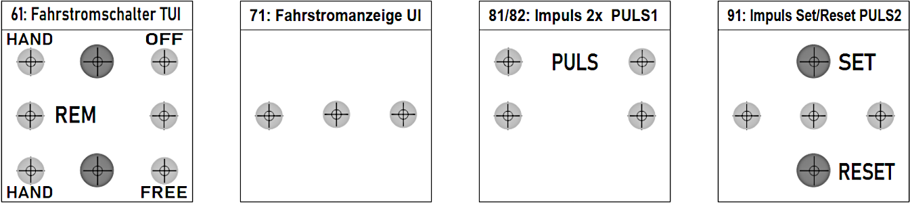   
> _Bild 7: Beschriftungen f&uuml;r die Steuerbl&ouml;cke_   

> Nach dem Aufkleben der Beschriftung werden die L&ouml;cher gebohrt. Der Bohrdurchmesser f&uuml;r die LED-Fassungen betr&auml;gt 5,6 mm, der f&uuml;r die Taster ca. 7 mm.   

> 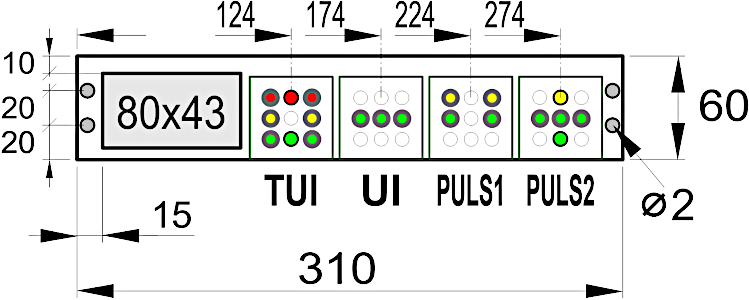   
> _Bild 8: Ma&szlig;e f&uuml;r die Frontplatte_   

Bei 3D-Druck bzw. bei Verwendung von Steuerblöcken mit 3D-Blockpanel werden quadratische Ausnehmungen (42 x 42 mm²) benötigt.  

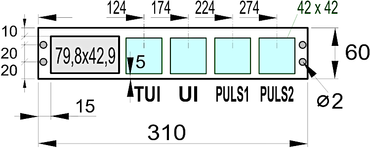   
_Bild 9: Ma&szlig;e f&uuml;r die 3D-Frontplatte_   

> __LED-Fassungen__   
> Bei _*Holzfrontplatte*_: Nach dem Bohren sind die Bohrungen zu entgraten (reinigen) und die LED-Fassungen einzupressen.   
> 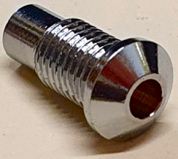   
> _Bild 10: LED-Fassung_   

>__Halterungen f&uuml;r Steuerbl&ouml;cke__   
> Bei _*Holzfrontplatte*_: Als N&auml;chstes kann man die Halterungen f&uuml;r die Steuerbl&ouml;cke mit 2,6 x 8 mm Schrauben anschrauben. Der Abstand der Bl&ouml;cke von der Unterseite des Rahmens sollte 5,5 mm betragen, allerdings ist die Lage der Halterungen meist durch die LED-Fassungen bereits vorgegeben...   
> Das Anziehen der Schrauben sollte nicht zu fest erfolgen, sodass sich die Sechskant-Distanzhalter nicht nach innen biegen!   

   

## 2.3 Zusammenbau des Rahmens
Der Zusammenbau des Rahmens erfolgt so, wie es im _Bild 1_ zu sehen ist. Als Schrauben werden zB selbstschneidende Schrauben 3 x 25 mm verwendet.   
Das Acrylglas wird mit Doppelklebeband befestigt und/oder mit Schrauben M 2 x 20 mm.   

   

## 2.4 Montage der Schaltbl&ouml;cke
Schaltblöcke mit 3D-Blockpanel werden in die quadratischen Ausnehmungen gesteckt.  

> Bei _*Holzfrontplatte*_: Die Schaltbl&ouml;cke werden auf die Blockhalterungen gesteckt und mit Schrauben M2 x 20 LEICHT angeschraubt.   

   

## 2.5 I²C-Verbindungen
F&uuml;r das Erstellen bzw. die Verwendung der Demo-Software ist die Kenntnis der Verdrahtung zwischen Schaltbl&ouml;cken und I²C-I/O-Expandern wichtig. Diese ist auch unter [`/software/rcc_demo2`](/software/rcc_demo2/LIESMICH.md) beschrieben.   

1. DCC 61, IO-Expander Pin 0,1: Fahrstromschalter (Schaltblock TUI)   
2. DCC 71, IO-Expander Pin 2,3: Fahrstromanzeige (Schaltblock UI)   
3. DCC 81,82, IO-Expander Pin 4,5: Impulsanzeige 2-fach (Schaltblock PULS1)   
4. DCC 91, IO-Expander Pin 6,7: Impulsanzeige Set/Reset (Schaltblock PULS2)   

Die IO-Pins zur Ansteuerung und zur R&uuml;ckmeldung werden normalerweise auf die gleichen Pin-Nummern verdrahtet.   

Die Umsetzung vom 10-poligen Schaltblock-Ausgang auf Einzelpins erfolgt entweder mit einzelnen 10pol_PIN-Platinen oder dem 4-fach Umsetzer `CON_4x10pol_io16 `.  

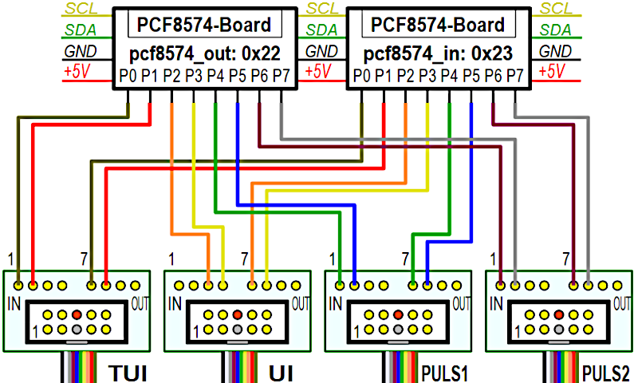   
_Bild 11: I²C-Verdrahtungsplan des Blocktesters #2_   

[Zum Seitenanfang](#up)   
   
   

## 3. Gleisbau
## 3.1 Montage der Gleise
Zum Testen der Impuls-Eingänge und der Sensoren werden unter dem Gleis zwei Reed-Kontakte und zwei Reflex-Lichtschranken montiert. Am besten verwendet man dazu einen 3D-gedruckten Bahnkörper. Dieser besteht aus dem [Bahndamm](./3d/fcstd/embankment/Blocktester2_Embankment_1_261109.FCStd) und dem [Gleisbett](./3d/fcstd/track/Blocktester2_track_ballast_1_261109.FCStd).  

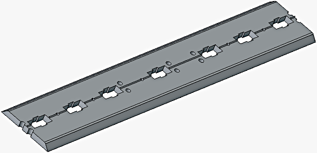  
_Bild 12: Bahndamm des Blocktesters #2_  

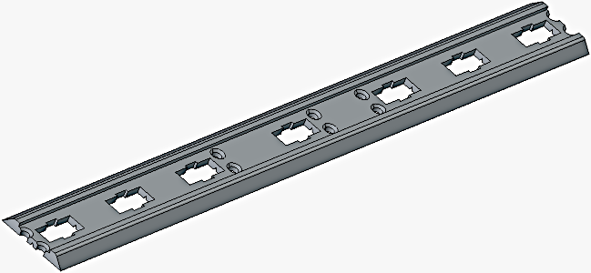  
_Bild 13: Gleisbett des Blocktesters #2_  

Die Reflex-Lichtschranken werden in die äußersten Ausnehmungen gesteckt, die Reed-Kontakte (mit Halterung) in die nächst inneren.  

Die Gleise werden mit Doppelklebeband befestigt, damit man sie bei Bedarf abbauen und anderwertig einsetzen kann.   

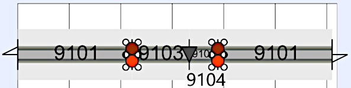  
_Bild 14: Gleisbild des Blocktesters #2_  

Das Gleis wird durch eine Trennstelle (die kleinen roten Rechtecke im _Bild 4_ bzw. das dunkelgraue Dreieck im _Bild 14_) in zwei Bereiche geteilt. Die braunen und roten Kreise symbolisieren die Fahrstromeinspeisungen (Bereich TUI und TU).  

Folgende Gleise werden ben&ouml;tigt:    

| Anzahl | Nummer | Name | Euro/Stk | Euro |   
| :---: | :---: | :--- |  ---: |  ---: |   
| 2 | 9101 | Gerade 111 mm | 4,40 | 8,80 |   
| 1 | 9103 | Gerade 55, 5 mm | 4,40 | 4,40 |   
| 1 | 9104 | Gerade 27,75 mm | 4,40 | 4,40 |   
| 1 | 9403 | Isolierschienenverbinder | 6,90 | 6,90 |   
| 2 | 22217 | 2-poliges Anschlusskabel | 4,90 | 9,80 |   
   
Gesamtkosten 2026: ca. 35 Euro   

   

## 3.2 Verdrahtung der Eisenbahn-Komponenten
Vor den Verdrahten wird grob die Position der einzelnen Platinen auf der Grundplatte festgelegt:  
* Modul-Verbinder mit Netzteil `SUB25_10`  
* Platine `CON_4x10pol_io16` vor den Schaltblöcken  
* Die i2c-Platinen davor. Kontaktstifte sollten sich gegenüberliegen.  
* Fahrstromerkennung in der Nähe des Gleises (`RCC_TUI_EXT` und `dcc_track_UI_TVn`). 
* 6-polige Sensoranschlussplatinen `CON_2x6pol_0`  

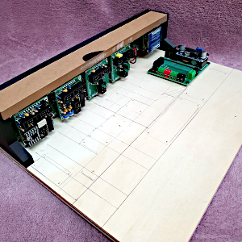  
_Bild 15: Anordnung der Verdrahtungsplatinen_  

An sich k&ouml;nnte die Verdrahtung auch direkt zu den Schaltbl&ouml;cken erfolgen, aber durch die Verwendung der Add-On-Platinen wird die Verdrahtung wesentlich &uuml;bersichtlicher und einfacher.   

[Zum Seitenanfang](#up)   
   

# 4. Software f&uuml;r den ESP32
Als Software wird die Demo-Software `rcc_demo2` (siehe [/software/rcc_demo2/LIESMICH.md)](/software/rcc_demo2/LIESMICH.md) verwendet.   

[Zum Seitenanfang](#up)   
   
   

# 5. Arbeiten mit dem Blocktester
## 5.1 Funktionstest des Blocktesters
* Anstecken des Anschlusskabels (mit 25-poliger Sub-D-Buchse)  
* Einschalten der Versorgung → Blocktester 2 fährt hoch  
* Blocktester 2 sucht das WiFi-Netzwerk `Raspi11`. Falls vorhanden loggt es sich ins WiFi-Netzwerk ein  
* der Status der Steuerblöcke wird &uuml;ber die Steuerblock-LEDs angezeigt.   

### Funktionstest an den Schaltbl&ouml;cken
Durch Dr&uuml;cken der Taster an den Schaltbl&ouml;cken k&ouml;nnen folgende Funktionen getestet werden:   
* Abschaltbares Gleis (TUI): Fahrspannung ein- und ausschalten  
* Impulserkennung (PULS2): Setzen und Rücksetzen des Relais  

Durch Verbinden der beiden Schienen mit dem (etwas befeuchteten) Finger schaltet die Fahrstromanzeige von grün auf gelb. 

### DCC-Funktionstest
Zus&auml;tzlich zum direkten Test sollte noch ein Funktionstest mit DCC (oder MQTT) durchgef&uuml;hrt werden. Am DCC-Eingabeger&auml;t (zB der Multimaus)   
* DCC-Adresse 61 w&auml;hlen und Fahrstrom ein- und ausschalten. Dabei dürfen beide Taster nicht verriegelt sein.  
* DCC-Adresse 81 w&auml;hlen und Puls-Eingang ein- und ausschalten.  
* DCC-Adresse 82 w&auml;hlen und Puls-Eingang ein- und ausschalten.  
* DCC-Adresse 91 w&auml;hlen und Puls-Eingang ein- und ausschalten.  

Sollte kein DCC-Eingabeger&auml;t aber daf&uuml;r ein Netzwerk mit MQTT-Broker zur Verf&uuml;gung stehen, so kann man die Funktion auch &uuml;ber MQTT testen. Dazu muss der PC (oder Laptop) mit dem WLAN `Raspi11` verbunden und ein Kommandofenster ge&ouml;ffnet werden. Durch Befehle dieser Art k&ouml;nnen die Bl&ouml;cke angesteuert werden:   

Einschalten des Fahrstroms:   
`mosquitto_pub -h 10.1.1.1 -t rcc/demo2/set/61 -m 1`   

Ausschalten des Fahrstroms:   
`mosquitto_pub -h 10.1.1.1 -t rcc/demo2/set/61 -m 0`   

#### Anzeige der MQTT-Nachrichten
Ein weiteres Kommando-Fenster öffnen und eingeben:  
`mosquitto_sub -h 10.1.1.1 -t rcc/demo2/# -v`   

Jetzt wird jede Aktion am Blocktester 2 durch eine MQTT-Nachricht dokumentiert.  

## 5.2 Beispiel: Test eines neuen Blocks
Waren alle Tests erfolgreich, k&ouml;nnen externe Bl&ouml;cke oder andere Komponenten gepr&uuml;ft werden.   
Zum Test eines Blocks m&uuml;ssen einfach das 10-polige Kabel (zum/vom I²C-Bus) und das 6-polige Kabel (zu/von Sensoren) direkt vom eingebauten Block abgesteckt und beim Pr&uuml;fling nebeneinander eingesteckt werden. Als Letztes wird eine der freien Buchsenstecker des 6-poligen Stromversorgungskabels am Pr&uuml;fling angeschlossen (senkrecht stehender Stecker J3).   
Der Test erfolgt wieder wie oben beschrieben.   

[Zum Seitenanfang](#up)

