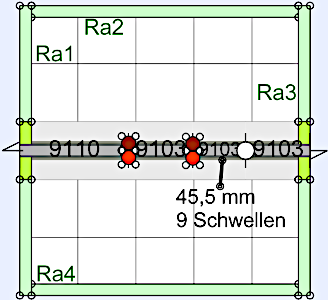
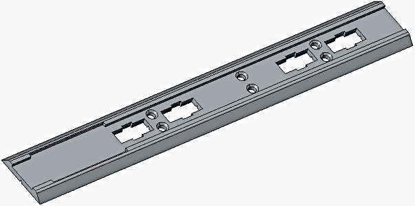
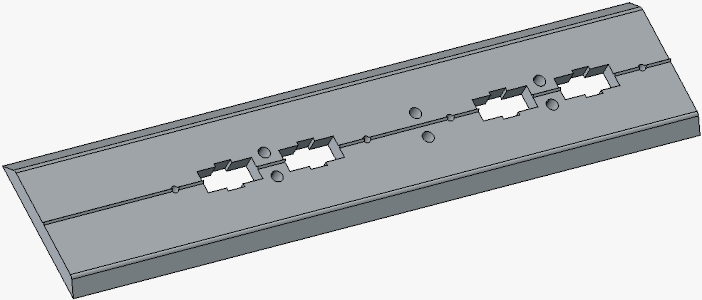
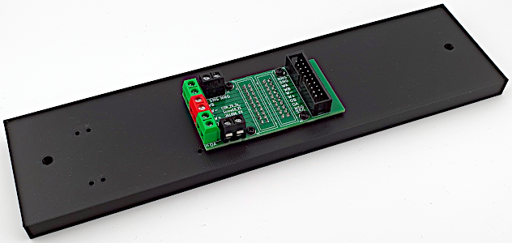
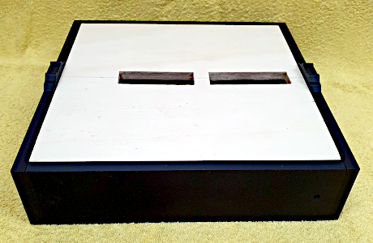
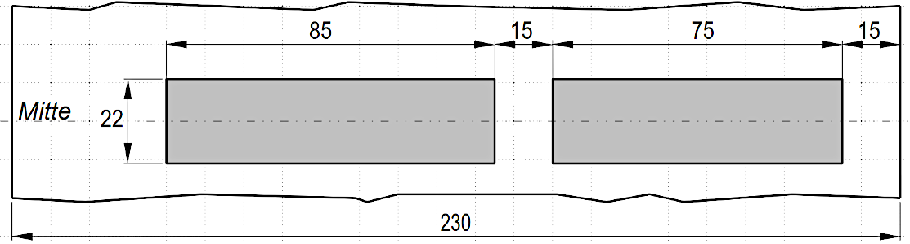
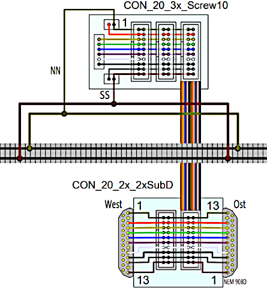
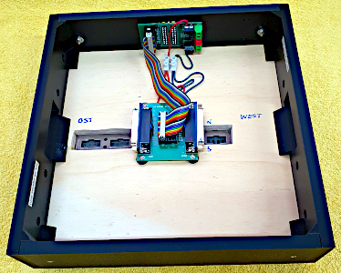

<table><tr><td></img></td><td>
<h1>Modul 16: Test Gleisbesetzterkennung</h1><b><big>Mini-Modul zum Testen von Gleisbesetzterkennung und Reedkontakten</big></b>   
Stand: 18.10.2026    &nbsp; &nbsp; &nbsp; &nbsp;
<a href="#TableOfContents">→ Inhaltsverzeichnis</a>&nbsp; &nbsp; &nbsp; &nbsp;
<a href="README.md">→ English version</a>
</td></tr></table>

   

# Worum geht es?
**Modul 16** ist ein gerades, nur **25 cm × 25 cm** großes Modul mit ESP32, OLED und zwei Plätzen für Schaltblöcke. Es ermöglicht die Einspeisung des Fahrstroms sowohl über 25-polige Sub-D-Stecker als auch über den 20-poligen Flachbandstecker **„P20“** (auf der Rückseite des Moduls).  

&nbsp;   
---  
---  
# --- ..ToDo.. --- In Arbeit --- ..ToDo.. --- In Arbeit ---  
---  

   
_Bild: Rahmen mit Grundplatte und Gleis_   

   
##  Inhalt
1. [Eigenschaften des Moduls](#x10)  
2. [Vorbereitung und Einkauf](#x20)  
3. [Rahmenbau](#x30)  
4. [Gleisbau](#x40)  
5. [Elektrik](#x50)  
6. [Probebetrieb](#x60)  
7. [Abschließende Arbeiten](#x70)  

   

# 1. Eigenschaften des Moduls
|                |                                                    |   
|----------------|----------------------------------------------------|   
| Modulgröße     | 25 x 25 cm²                                        |   
| Gleismaterial  | Fleischmann Spur-N-Gleis mit Schotterbett          |   
| Gleisbild      | Gerade mit Ausgleichsgleis                         |   
| Elektrischer Anschluss | * 2x 25-poliger SUB-D-Stecker (entsprechend NEM 908D, je 1x WEST und OST)    * 2x 20-poliger Wannenstecker (auf der Rückseite) |   
| Fahrstrom     | Analog- oder DCC-Betrieb |   
| Steuerung der Schaltkomponenten | * H&auml;ndisch direkt an der Modulvorderseite   * &uuml;ber DCC   * durch MQTT-Nachrichten (&uuml;ber WLAN) |   
| Bedienelemente mit R&uuml;ckmeldung | 1x OLED-Display und Taster   1x DCC-Fahrstromerkennung **mit** Schalten (Block TUI, DCC 161)   1x Anzeige Pulserkennung (Block PULS1, DCC 162) |   
| WLAN           | SSID: &nbsp; &nbsp; &nbsp; `Raspi11`   Passwort: `12345678` |   
| MQTT: IP-Adresse des Brokers (Host) | `10.1.1.1` |   
| Sonstiges | * Einfaches Verbinden mit anderen Modulen durch ein ausziehbares Gleis am Segment-Ende |   

   
   

# 2. Vorbereitung und Einkauf

## 2.1 Schienenkauf
### 2.1.1 Entwurf des Gleisplans

Auf der Westseite (links) befindet sich ein Ausziehgleis, das das Verbinden mit anderen Modulen erleichtert.  
Um die Modullänge von 25 cm zu erreichen, wird ein gerades Gleis (z. B. 9103) auf **45,5 mm (9 Schwellen)** gekürzt.  

Der folgende Gleisplan wurde mit [AnyRail](https://www.anyrail.com/) erstellt.  

  
_Bild: Gleisplan Modul 15_  

Die braunen und roten Kreise markieren die Fahrstromeinspeisungen.  

### 2.1.2 Schienenkauf - St&uuml;ckliste
| Anzahl | Nummer | Name | Euro/Stk | Euro |   
| :---: | :---: | :--- |  ---: |  ---: |   
| 1 | 9110 | Ausgleichsgleis gerade 83mm-111mm | 14,60 | 14,60 |   
| 3 | 9103 | Gerade 55, 5 mm | 4,40 | 13,20 |   

Gesamtkosten 2025: ca. 27,80 Euro   

   

## 2.2 Rahmen
### 2.2.1 Modulrahmen
Der 25 x 25 cm² gro&szlig;e Modulrahmen ist 6 cm hoch und besteht aus zwei Seitenteilen ("Ost" und "West") und zwei L&auml;ngsteilen ("Nord" und "S&uuml;d") ohne Querstreben. Die Gel&auml;ndeplatte wird in den Rahmen eingelegt.   
Die Teile des Rahmens k&ouml;nnen entweder aus Holz hergestellt oder mit dem 3D-Drucker gedruckt werden. Auch eine gemischte Bauweise ist m&ouml;glich, zB Seitenteile 3D-Drucken, L&auml;ngsteile aus Holz.   

### 2.2.2 Holz-Rahmen

> Material, das nur bei Verwendung eines Holzrahmens benötigt wird:  
>
> #### Pappelsperrholz 10 mm
> | St&uuml;ck | Abmessung     | Kurzbezeichnung | Verwendung             |   
> |:-----:|:-------------:|:--------:|:-----------------------|   
> |   1   | 230 x 230 mm² |     -    | Gel&auml;nde-Grundplatte    |   
> |   2   | 230 x 60 mm²  | Ra2, Ra4 | Rahmen au&szlig;en Nord, S&uuml;d |   
> |   2   | 250 x 70 mm²  | Ra1, Ra3 | Rahmen au&szlig;en West, Ost |   
> 
> #### Holzrahmen: Kleinteile
> 4x Pappelsperrholz 10 mm stark, 70 x 35 mm² f&uuml;r die Halterungen der Sub-D-Stecker.   
> 4x kleine Holzst&uuml;cken 10 x 10 x 50 mm³ als zus&auml;tzliche Auflager f&uuml;r die Grundplatte. 
> 
> #### Holzrahmen: Verbrauchsmaterial
> Zum Verleimen und Lackieren des Holzes:  
> 
> | St&uuml;ck | Nummer | Lieferant  | Bezeichnung      |   
> |:----------:|:------:|:-----------|:-----------------|   
> |      1     |        | Ponal      | Holzleim Express |   
> |      1     | 4002364114016 | Albrecht   | Yacht- und Bootslack, farblos, > hochgl&auml;nzend |   
> |      1     |   |   | Topfreiniger (Abwasch-Schwamm) |   
> |      2     |   |   | Paar Einmal-Handschuhe         |   
> |      1     |   |   | Schleifpapier K&ouml;rnung 240      |   
>

### 2.2.3 3D-Rahmen
Folgende vier Teile 3D-drucken:  
* 2x Seitenteile: [`frame_side_single-track_261013.FCStd`](https://github.com/khartinger/RCC5V/blob/main/fab/3d/frame_side_single-track_261013.FCStd)  
* 1x Längsteil Nord: [`frame_back_N_2xP20_230mm_261013.FCStd`](https://github.com/khartinger/RCC5V/blob/main/fab/3d/frame_back_N_2xP20_230mm_261013.FCStd)  
* 1x Längsteil Süd: [`frame_front_S__230mm_261013.FCStd`](https://github.com/khartinger/RCC5V/blob/main/fab/3d/frame_front_S__230mm_261013.FCStd)  
* Gelände-Grundplatte: **Pappelsperrholz 10 mm**, 230 x 230 mm²

#### 3D-Rahmen: Verbrauchsmaterial
Zum Kleben der 3D-Teile:  

| St&uuml;ck | Bezeichnung      | Lieferant  |  
|:----------:|:-----------|:-----------------|   
|      1     | 3D Druck Sekundenkleber, Gel | Kraftprotz [(Amazon)](https://www.amazon.de/Sekundenkleber-3D-Druck-Gel-50/dp/B0CBSGWZRW?__mk_de_DE=%C3%85M%C3%85%C5%BD%C3%95%C3%91&crid=CYU745CNDNK&dib=eyJ2IjoiMSJ9.W5s5lhw4Zno1-SxDPW0cox7leaRGQ24ez8VxqJJ6MZ-bzI60hfXqha_ID6GSBfoYudWCvT7sI-iGo-KdEVf6ibbYWDtbqQ_KZhN_i0mzlvm4qbMmrJCQnv71omcqdKCVSpgbDyKKc9BIsqhrUIgOHUiGqJMONDmBxdaF_n8_VuM_-fIPwCiSXEsLu87UXrlW2We9bZbFalroOILby_mW--ApWpsVBaKH-P6YX1JGCPPlvFb-Bozk6iTX494l5ENx1G3MZGHwLcmovKPIodpkeWrZ0xVy9W_1lwDsV9nkXjo._WLstUNmlWC3w4Ng5KXDrLQ3m3r0ruJrsW306wKEC9s&dib_tag=se&keywords=3d%2Bdruck%2Bkraftprotz&qid=1791989113&sprefix=3d%2Bdruck%2Bkraftprot%2Caps%2C207&sr=8-1&th=1) |  

### 2.2.4 Bahnkörper
Der Bahnkörper für N-Spur hat folgenden Aufbau:

   

Der Bahnkörper kann entweder traditionell aus Holz, Kork und Schaumstoff oder in 3D-Druck hergestellt werden.  

> 
> #### Bahnkörper traditionell
> 
> | St&uuml;ck | Abmessung     | Material | Anmerkung |   
> |:-----:|:-------------:|:----------|:----------|   
> |   1   | 50 x 250 mm² | Pappelsperrholz 5 mm (oder 4 mm) | Bahndamm  |   
> 
> Sollte kein 5 mm Sperrholz zur Verf&uuml;gung stehen, kann man auch 4 mm starkes Sperrholz verwenden. In diesem Fall wird später ein 1 mm dicker, selbst klebender Kork aufgeklebt.   
> 
> | St&uuml;ck | Nummer | Lieferant  | Bezeichnung      |   
> |:----------:|:------:|:-----------|:-----------------|   
> |      1     |  95962 | Noch       | Gleisbett-Rolle N 730 cm lang, 3,2 cm breit, 0,3 cm stark |   
> 

#### Bahnkörper im 3D-Druck
* Gleisbett: [M15_track_ballast_1_260831.FCStd](https://github.com/khartinger/RCC5V/blob/main/examples/module15/3d/fcstd/M15_track_ballast_1_260831.FCStd)   
  

* Bahndamm: [M15_embankment_1_260831.FCStd](https://github.com/khartinger/RCC5V/blob/main/examples/module15/3d/fcstd/M15_embankment_1_260831.FCStd)  
  

### 2.2.5 Kleinteile

| St&uuml;ck | Bezeichnung | Anmerkung |  
|:-----:|:--------------|:----------|  
|  8  |  Schraube M3 x 30 mm Senkkopf, Kreuzschlitz, selbstschneidend  |  zB Fa. Spax 4 003530 021251  |  
|  4  | Abstandsbolzen M3 x 10 + 6 mm, Messing  |  |  
|  4  | Beilagscheiben M3, Da 9 mm, Edelstahl |  |  
|  4  | Mutter M3 |  |  

### 2.2.6 Staubabdeckung
Falls eine Staubabdeckung gewünscht ist:  

| St&uuml;ck | Bezeichnung | Anmerkung |  
|:-----:|:--------------|:----------|  
|  4  | Rändelschraube M3 x 10 |  |  
|  1  | 5 mm Plexiglas 250 x 230 mm² | Vorne |  
|  1  | 5 mm Plexiglas 250 x 265 mm² | "Deckel" |  
|  1  | 10 mm Pappelsperrholz 250 x 230 mm² | Rückwand |  

Siehe dazu auch [https://github.com/khartinger/RCC5V/blob/main/info/dust_cover/LIESMICH.md](https://github.com/khartinger/RCC5V/blob/main/info/dust_cover/LIESMICH.md)  

   

## 2.3 Elektrische Komponenten
### 2.3.1 P20-Anschluss
Als Anschluss für eine 20-polige Flachbandkabel-Buchse ("P20") wird das Board `CON_20_2x_2x6pol_R_V2` verwendet.  

   

Der Bau ist [hier](https://github.com/khartinger/RCC5V/blob/main/fab/rcc7_p20/LIESMICH.md#x32) beschrieben.  

### 2.3.2 P20-Sub-D-Umsetzer
Zum Umsetzen von P20 auf Sub-D-Stecker wird das Board `CON_20_2x_2xSubD` verwendet.  

   

Der Bau ist [hier](https://github.com/khartinger/RCC5V/blob/main/fab/rcc7_p20/LIESMICH.md#x12) beschrieben.  

### 2.3.3 Schaltblöcke
#### TUI

#### PULS1

### 2.3.4 Elektrisches Kleinmaterial
| St&uuml;ck | Bezeichnung | Anmerkung |  
|:-----:|:--------------|:----------|  
| 15 cm | 20-poliges Flachbandkabel, Rastermaß 1,27 mm | [1] |  
|  2  | 20-polige IDC-Pfostenverbinder und Zugentlastung | [1] |  
| ca. 50 cm | Volldraht 18 awg (oder 22 awg) braun (oder grün) | |  
| ca. 50 cm | Volldraht 18 awg (oder 22 awg) rot | |  
| 1 | Lüsterklemme 2-polig |  |  
| 1 | Lötzinn 0,5 mm |  |  

[1] Zum Verbinden der Stecker `P20-Anschluss` in Nord und `P20-Sub-D-Umsetzer`.  

   
   

# 3. Rahmenbau

## 3.1 Einleitung
Jedes Modul besteht aus einem Rahmen mit Querverbindungen und der Grundplatte, die die Gleise und Landschaft tr&auml;gt. Zuerst erstellt man den Modul-Rahmen. Das hat zwei Vorteile:   
1. Der Test, ob die Grundplatte in den Rahmen passt, kann mit der leeren Grundplatte erfolgen. Falls die Grundplatte zu gro&szlig; ist, kann sie einfach zugeschnitten oder zugeschliffen werden.   
2. Beim Aufkleben der Gleise auf die Grundplatte sind an den Modul&uuml;berg&auml;ngen (Ost und West) bereits die Seitenteile mit den Gleisausnehmungen vorhanden. So sind die Gleise beim Aufkleben sicher an der richtigen Position.   

Der Rahmen des Moduls 15 besteht aus vier Teilen:  
* 2x Seitenteile: [`frame_side_single-track_261013.FCStd`](https://github.com/khartinger/RCC5V/blob/main/fab/3d/frame_side_single-track_261013.FCStd)  
* 1x Längsteil Nord: [`frame_back_N_2xP20_230mm_261013.FCStd`](https://github.com/khartinger/RCC5V/blob/main/fab/3d/frame_back_N_2xP20_230mm_261013.FCStd)  
* 1x Längsteil Süd: [`frame_front_S__230mm_261013.FCStd`](https://github.com/khartinger/RCC5V/blob/main/fab/3d/frame_front_S__230mm_261013.FCStd)  

   

## 3.2 Seitenteile `frame_side_single-track`  
Die Seitenteile sind an eine (ehemalige?) Norm von n-spur.at angelehnt, wobei das Bahnk&ouml;rper-Profil der NEM122 entspricht:   

  

   
_Bild: Ma&szlig;e f&uuml;r die Seitenteile Ost und West (Modulbreite 250mm, ein in der Mitte liegendes Gleis)._   

* Die vier 8mm-Bohrungen dienen zum Verbinden der Module mit 8 mm-Fl&uuml;gelschrauben und Fl&uuml;gelmuttern.   
* Die linken und rechten vier 2 mm-Bohrungen dienen zum Anschrauben der Nord- und S&uuml;dwand.   
* Die oberen zwei 2mm-Bohrungen dienen zum Fixieren der Gel&auml;nde-Grundplatte (falls erforderlich).   
* Die 60x20 mm²-Ausnehmung dient zum Durchf&uuml;hren des 25-poligen Sub-D-Steckers.   

   

## 3.3 Leerer Vorderteil `frame_front_S__230mm`  

   

Die beiden Sechskant-Ausnehmungen (Seitenlänge M 3 mm) dienen zur Befestigung einer Plexiglasabdeckung.  

   

   

### Einsschlagen der Abstandsbolzen
1. Abstandsbolzen M3 x 10 + 6 mm erwärmen (zB mit einem Fön).  
2. Abstandsbolzen von der Rahmenaußenseite her einschlagen.  
   **Wichtig:** zwei Holzstücke unterlegen, damit das Gewinde auslaufen kann.  
   

Auf der Innenseite:  

3. Beilagscheibe M3, Da 9 mm über Gewinde stülpen.  
4. Mutter M3 aufschrauben, mit 5,5 mm Schlüssel anziehen.  

   

## 3.4 Nordteil `frame_back_N_2xP20_230mm`

   

Maße der Ausnehmung für die P20-Stecker:  
   

### Montage des `CON_20_3x_Screw10`-Boards
Das `CON_20_3x_Screw10`-Board wird mit 4 Stück M 2,6 x 10 mm Schrauben auf das Rahmenteil geschraubt.  
   

### Einsschlagen der Abstandsbolzen
Wie [oben](#spacerbolt) beschreiben.  

   

## 3.5 Zusammenbau des Rahmens
1. Anordnen der Rahmenteile auf einer ebenen Fläche im Quadrat.  
2. Gelände-Grundplatte auf die Rahmenteile legen.  
3. Zusammenschrauben des Rahmens mit 8 Schrauben M3 x 30 mm (Senkkopf, Kreuzschlitz, selbstschneidend).  

   

   
   

# 4. Gleisbau
## 4.1 Stellprobe
> * __*Bei Holzbau*__: Gleisbild auf die "Bahndammplatte" (230 x 50 mm² Sperrholzplatte) zeichnen.  
* Falls auf dem Modul Gebäude etc. geplant sind: Alle bahnspezifischen Bauwerke (wie Bahnhof, Bahnsteige, Verladerampe) aufstellen.  
* Die "Bahndammplatte" oder den 3D-gedruckten Bahnkörper (Bahndamm und Schotterbett) zwischen die Seitenteile einpassen.  
* Gleise auflegen.  
* Mit dem l&auml;ngsten Waggon h&auml;ndisch eine Probefahrt durchf&uuml;hren.  

   

## 4.2 Bahndamm
> __*Bei Holzbau*__: Die seitlichen Kanten des Sperrholzes unter 45° abschrägen.  

   

## 4.3 Ausnehmungen in der Gelände-Grundplatte
Ausnehmungen bzw. Bohrungen in der Grundplatte (und im Holz-Bahndamm) sind erforderlich für
* Fahrstrom-Anschlussdrähte  
* Unterflurantriebe für Weichen etc.  
* Reed-Kontakte, Refelxkoppler und sonstige Sensoren  

Modul 15 hat nur die Fahrstromanschlüsse, trotzdem kann man Ausnehmungen für Reed-Kontakte vorsehen:  
   
Mit den Abnehmungen sind auch die Bohrungen für die Stromanschlüsse abgedeckt.  

   

## 4.4 Gleisbett (Bettungskörper)
> __*Bei Holzbau*__: 3 mm hohes Schaumstoff-Gleisbett (Fa. Noch Nr. 95962 oder Kork) auf den Bahndamm aufkleben.  

__*Bei 3D*__:  
1. Den ausgedruckten Bahndamm auf das Schotterbett kleben = Gleisbett.  
2. Das Gleisbett auf die Grundplatte kleben.  

   

## 4.5 Gleisbau
### Anbringen der Stromversorgung am Gleis

Zur Stromversorgung kann man das Fleischmann-Anschlusskabel 22217 (2-polig, Spur N) verwenden oder selbst Drähte an die Gleisverbinder löten. Das funktioniert bei Fleischmann-Gleisen mit Schotterbett gut. Gleisverbinder ohne Schotterbett lassen sich dagegen kaum löten.  

Als Anschlussdrähte verwendet man ca. 20 cm lange, braune und rote Volldrähte mit 0,32 mm² (22 AWG). **Braun** ist für die nördliche, **Rot** für die südliche Schiene vorgesehen.  

Die Drähte werden an beiden Enden ca. 6 mm abisoliert. Für den Anschluss an den Gleisverbinder biegt man ein Ende hakenförmig, drückt es mit einer kleinen Zange etwas flach und verzinnt es.  

Zum Löten fixiert man das Gleis am besten mit einem Klebestreifen. Anschließend schneidet man mit einem Stanley-Messer die kleine Kunststoffverbindung über dem Gleisverbinder heraus, damit dieser besser zugänglich ist. Danach verzinnt man den Gleisverbinder.  

Im Bild unten ist rechts unten die Kunststoffverbindung über dem Gleisverbinder zu sehen. Rechts oben wurde sie bereits entfernt.  

### Gleise aufkleben
* Alle Kabel in die Bohrungen einf&auml;deln und nach unten ziehen, bis die Gleise etwa 5 bis 10 cm Abstand zur zuk&uuml;nftigen Position haben. Die Grundplatte etwas schr&auml;g stellen, damit die Kabel nicht geknickt werden.   
* Alle Bereiche markieren, auf die kein Leim aufgetragen werden darf (oder mit Klebeband abdecken):   
  * Ausgleichsgleis am linken Rand (West)   
> * __*Bei Holzbau*__: Gleisbett mit Weißleim versehen, **nicht** jedoch beim Ausgleichsgleis (!)  
* __*Bei 3D*__: Doppelklebeband anbringen, **nicht** jedoch beim Ausgleichsgleis (!)  
* Gleise fertig zusammenstecken und vorsichtig an den Kabeln ziehen, bis die Gleise auf dem Leim liegen. 

### Ergänzungen
* Das Ausgleichsgleis wird beim Zusammenstecken von Modulen mechanisch in Längsrichtung beansprucht. Es sollte daher mit einem Gleisnagel zusätzlich fixiert werden. Der Gleisnagel wird auf der vom Modulrand abgewandten Seite eingeschlagen.  

   
   

# 5. Elektrische Verdrahtung des Moduls   
## 5.1 Verdrahtungsplan
Das folgende Bild zeigt eine &Uuml;bersicht &uuml;ber die Verdrahtung der verwendeten Komponenten:   

   

   

## 5.2 Verdrahtung des Fahrstroms
Die Drähte vom Gleis werden auf eine Lüsterklemme verschraubt und von dort führen zwei Drähte zu den Anschlüssen NNG und SSG auf dem `CON_20_3x-Screw10`-Board.  

   

## 5.3 Verdrahtung P20 - Sub-D
1. Festschrauben des `P20-Sub-D-Umsetzer`-Boards auf der Unterseite der Grundplatte mit M 2,6 x 12 mm Schrauben und Gummi-Abstandshaltern.  
2. Verbinden des P20-Anschlusses mit dem P20-Sub-D-Umsetzer durch ein ca. 15 cm langes, 20-poliges Flachbandkabel.  

  

## 5.4 Elektrischer Test
Zur Durchführung des elektrische Tests wird die Pin-Belegung der Stecker benötigt:  

**Pinbelegung Sub-D-Stecker**  
   

**Pinbelegung P20-Stecker**  
  

**Testvorbereitung**  
1. Kabel mit 25-poligen Sub-D-Buchsen am **WEST**-Stecker des Moduls anstecken.  
2. 20-poliges Flachbandkabel am P20-Stecker anstecken.  
3. Drähte an die Klemmen des Ohmmeters anklemmen.  

Folgende Verbindungen sollten bestehen:  
| Bezeichnung | P20-Stecker  | Sub-D-Kabel Buchse West | Bedeutung |  
|:----:|:----:|:-----:|------|  
| NNG  |  1,2  |  13  | Nördliche Schiene des nördlichen Gleises (DCC Fahrstrom) |  
| SNG  |  3,4  |  11  | Südliche Schiene des nördlichen Gleises (DCC Fahrstrom) |  
| WA   |  5,6  |  10  | Steuerleitung West A (DCC Signal für Zubehör) |  
| WB   |  7,8  |   9  | Steuerleitung West B (DCC Signal für Zubehör) |  
| AC-  |  9,10 |  8,6 | Trafo Wechselspannung 18V~ oder Gleichspannung 24V- |  
| AC+  | 11,12 |   7  | Trafo Wechselspannung 18V~ oder Gleichspannung 24V+ |  
| OB   | 13,14 |   5  | Steuerleitung Ost B (nicht benutzt) |  
| OA   | 15,16 |   4  | Steuerleitung Ost A (nicht benutzt) |  
| NSG  | 17,18 |   3  | Nördliche Schiene des südlichen Gleises (DCC Fahrstrom) |  
| SSG  | 19,20 |   1  | Südliche Schiene des südlichen Gleises (DCC Fahrstrom) |  

Weiters sollte NNG mit der nördlichen Schiene und SSG mit der südlichen Schiene verbunden sein.  

   
   

# 6. Probebetrieb
## 6.1 Fahrstromversorgung über Sub-D-Stecker
### Teil 1: Funktionstest Modul 15
1. Anstecken der (Standard-)Versorgung am Sub-D-West-Anschluss.  
2. Einschalten der DCC-Versorgung.  
3. Kurze Probefahrt mit einer Lok.  

### Teil 2: Kompatibilitätstest
Dieser Test dient zur Kontrolle, ob der Modul zu bereits bestehenden Modulen dazupasst.  

1. Verbinden von Modul 15 mit einem bereits vorhandenen Modul mit Gleisen und Weichen mit Sub-D-Kabel.  
2. Fahrtest mit einer Lok.  
3. Schalten einer Weiche über DCC.  

   

## 6.2 Fahrstromversorgung über Flachbandkabel
1. Umsetzen der (Standard-)Versorgung auf ein 20-poliges Flachbandkabel mit einem `CON_20_SubD_W`-Board oder einem zweiten `P20-Sub-D-Umsetzer`.  
2. Verbinden des Umsetzers mit dem P20-Eingang von Modul 15.  
3. Durchführung der Tests wie oben beschrieben.  

   
   

# 7. Abschließende Arbeiten

## 7.1 Minimale Landschaftsgestaltung
Die einfachste "Landschaftsgestaltung" besteht darin, den Rand der Gleise einzuschottern und das Gel&auml;nde mit gr&uuml;ner Farbe zu bemalen. Nimmt man verschiedene Gr&uuml;n- und Gelbt&ouml;ne, so ist das Ergebnis durchaus brauchbar.   
   

Im n&auml;chsten Schritt k&ouml;nnte man Grasflocken und B&auml;ume aufbringen oder Gebäude etc. hinzuf&uuml;gen. Das &Uuml;bermalen der gr&uuml;nen Farbe ist dabei kein Problem....   

   

## 7.2 Plexiglas-Abdeckung
Siehe dazu [https://github.com/khartinger/RCC5V/blob/main/info/dust_cover](https://github.com/khartinger/RCC5V/blob/main/info/dust_cover/LIESMICH.md).  

   

## 7.3 Bodenabdeckung
Um die Verkabelung zu sch&uuml;tzen, kann man auch Teile des Bodens mit durchsichtigen Folien (zB mit 1 mm St&auml;rke) abdecken.   

   

## 7.4 Modell-Hintergrundbild
Das Modellhintergrundbild sollte bei 25 cm Modultiefe zumindest 15,5 cm hoch sein.   

[Zum Seitenanfang](#up)   