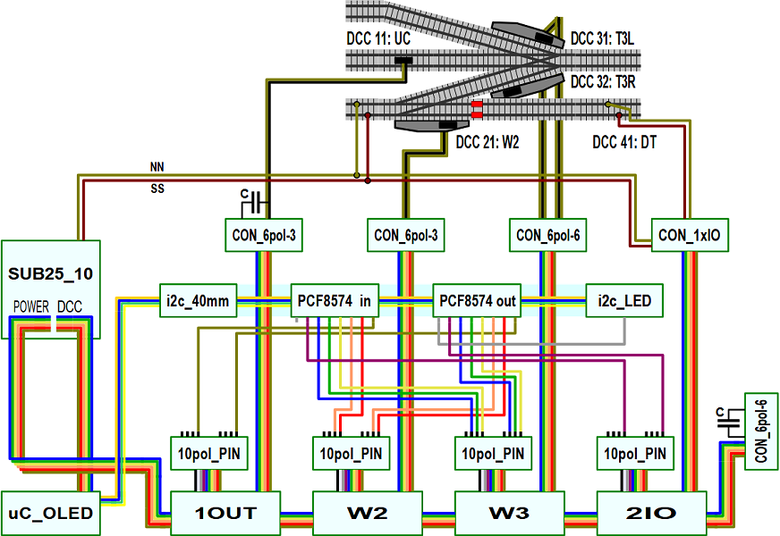

<a name="up"></a>
<table><tr><td></img></td><td>
<h1>RCC Demo-Software rcc_demo1m</h1><b><big>Überblick über die Demo-Software 1 zum Steuern von Modellbahn-Komponenten</big></b><br>  
Stand: 21.11.2026    &nbsp; &nbsp; &nbsp; &nbsp;
<a href="#TableOfContents">→ Inhaltsverzeichnis</a>&nbsp; &nbsp; &nbsp; &nbsp;
<a href="README.md">→ English version</a>
</td></tr></table>

<a name="x10"></a>   

# 1. Einführung
Jedes Modellbahn-Modul besitzt einen eigenen **ESP32-Mikrocontroller** als zentrale Steuereinheit. Die **RCC-Demo-Software** bildet die Basis für diese Steuerung und lässt sich leicht an eigene Anforderungen anpassen.

Die Software `rcc_demo1m` testet fünf grundlegende Schaltblöcke über zwei PCF8574-I/O-Expander. Sie kann direkt mit der Hardware [Blocktester](https://github.com/khartinger/RCC5V/blob/main/examples/blocktester/LIESMICH.md) verwendet werden.

Diese Datei gibt einen Überblick über die RCC-Demo1m-Software.  
Weitere Informationen:  
- **[CUSTOMIZE_D.md](./CUSTOMIZE_D.md):** Anpassung der Software an eigene Anforderungen
- **[DETAILS_D.md](./DETAILS_D.md):** Technische Beschreibung der Software

<a name="TableOfContents"></a>   

## Inhaltsübersicht
* [1. Einführung](#x10)  
* [2. Kenntnisse über die Hardware](#x20)  
* [3. Software-Überblick](#x30)  

## Unterstützte Steuerblöcke

Die Software enthält Handler für folgende Komponententypen:

| Typ | Funktion |
| --- | -------- |
| `RC_TYPE_UC` | Entkuppler |
| `RC_TYPE_TO` | Zweiwegweiche |
| `RC_TYPE_T3` | Dreiwegweiche |
| `RC_TYPE_DT` | Abschaltbares Gleis |
| `RC_TYPE_TX` | Doppelkreuzungsweiche |
| `RC_TYPE_DD` | Doppelpoliger Umschalter |
| `RC_TYPE_TUI` | Fahrstromschalter mit Rückmeldung von Fahrspannung und Gleisbelegung |
| `RC_TYPE_UI` | Anzeige für Gleisspannung und Gleisstrom |
| `RC_TYPE_P1` | Impuls-Ausgang; die angeschlossene Hardware setzt den Impuls zurück |
| `RC_TYPE_P2` | Set-/Reset-Impuls mit zwei Ausgängen |
| `RC_TYPE_BL` | Blinklicht |

Die aktuelle Demo-Konfiguration verwendet `UC`, `TO`, zwei `T3`-Adressen, `DT` und `BL`. Die übrigen Typen sind Beispiele für mögliche Konfigurationen; ihre Definitionen in `rcc_config.h` sind auskommentiert.

Zur Konfiguration der Software sind Informationen zur Verdrahtung der Hardware erforderlich.  

<a name="x20"></a>   

# 2. Kenntnisse über die Hardware
Die Ansteuerung und Rückmeldung erfolgen über PCF8574-I/O-Expander am I²C-Bus. Üblicherweise werden die Boards paarweise verwendet: ein Ausgangs-Board und ein Eingangs-Board. In der Standardkonfiguration sind ihre 7-Bit-I²C-Adressen `0x20` und `0x21`.

Im Programm sind `EX0` und `EX1` die Array-Indizes dieser Boards (0 für Ausgang, 1 für Eingang), nicht deren I²C-Adressen. Jeder PCF8574 hat die Pins 0 bis 7. Welche Pins an den Schaltblock angeschlossen sind, muss bekannt sein und in `rcc_config.h` eingetragen werden.

Für die Software ist die Kenntnis der **Verdrahtung zwischen Schaltblöcken und I²C-Expandern** unbedingt erforderlich.

## Aktive Demo-Komponenten

| DCC-Adresse | Typ / Funktion | Ausgänge | Rückmeldungen |
| ----------- | -------------- | -------- | ------------- |
| 11 | `UC`, Entkuppler | `EX0`, Pin 0 | `EX1`, Pin 0 |
| 21 | `TO`, Zweiwegweiche | `EX0`, Pins 1 und 2 | `EX1`, Pins 1 und 2 |
| 31, 32 | `T3`, Dreiwegweiche | `EX0`, Pins 3/4 bzw. 5/4 | `EX1`, Pins 3/4 bzw. 5/4 |
| 41 | `DT`, abschaltbares Gleis | `EX0`, Pin 6 | `EX1`, Pin 6 |
| 51 | `BL`, Blinklicht | `EX0`, Pin 7 | keine |

## I²C-Verdrahtung

   
_Bild 1: &Uuml;bersichtsplan des Blocktesters_   

Weitere Informationen zum [Blocktester unter `/examples/blocktester`](https://github.com/khartinger/RCC5V/blob/main/examples/blocktester/LIESMICH.md)

<a name="x30"></a>

# 3. Software-Überblick

## Funktionen der Software
* Ansteuerung von Schaltblöcken.  
* Anzeige des Schaltzustands der Komponenten auf einem 1,54"-OLED-Display.  
* Mit dem Taster am Pin IO19 (D6) kann man die einzelnen Seiten der Informationsanzeige oder das Suchen nach dem WLAN überspringen.  
* Dr&uuml;ckt man w&auml;hrend des Programmlaufs den Taster an IO19 f&uuml;r mehr als eine Sekunde, wird ein Reset ausgel&ouml;st. Dies kann zB dazu verwendet werden, um beim erneuten Hochfahren das WLAN zu aktivieren.  
* Empfang von DCC-Befehlen.  
* Empfang und Senden von MQTT-Nachrichten.  

Die wesentlichen projektspezifischen Einstellungen wie WLAN, MQTT und Hardware stehen in `rcc_config.h`. Start- und Status-Texte stehen in `rcc_demo1m_text.h`; die Sprache wird in `rcc_demo1m.cpp` ausgewählt.

## Entwicklungsumgebung
Das Programm wird mit Visual Studio Code (VSC) und PlatformIO erstellt.  
Nach dem Kompilieren in VSC wird das Programm mit VSC auf den ESP32 übertragen.   

## Konfigurationsdatei
Die für ein Projekt wichtigsten Einstellungen stehen in `rcc_config.h`; sprachabhängige Start- und Status-Texte in `rcc_demo1m_text.h`. Die Sprache (`'d'` oder `'e'`) wird in `rcc_demo1m.cpp` gewählt.

`rcc_config.h` enthält unter anderem:

* Netzwerk- und MQTT-Daten   
* Display-Daten   
* DCCex-Daten   
* IO-Expander PCF8574-Daten   
* die unterstützten Komponententypen sowie die Definitionen der aktiven Komponenten (`RCOMP_NUM` und `RCOMP_LIST`)
   
Weitere Infos zur Konfiguration stehen in **[CUSTOMIZE_D.md](./CUSTOMIZE_D.md):** Anpassung der Software an eigene Anforderungen   

## Programmversion
Bei jeder &Auml;nderung am Programm sollte die Programmversion in der Konfigurationsdatei angepasst werden. `VERSION_99` sollte das Datum und den Dateinamen enthalten, `VERSION_99_1` den Text "Version" und das Datum.   
Der Inhalt von `VERSION_99` wird als Antwort auf eine MQTT-GET-Anfrage angezeigt. Bei der Standard-Themenbasis `rcc/demo1m` lautet der Befehl beispielsweise:

```sh
mosquitto_pub -h 192.0.2.10 -t rcc/demo1m/get -m version
```

`192.0.2.10` ist eine Beispieladresse aus dem Dokumentationsbereich und muss durch die Adresse des eigenen MQTT-Brokers ersetzt werden. Falls die Themenbasis zuvor geändert und gespeichert wurde, muss auch das GET-Thema entsprechend angepasst werden.

Der Inhalt von `VERSION_99_1` wird beim Start f&uuml;r eine Sekunde in der letzten Zeile des Displays angezeigt und sollte nicht l&auml;nger als 21 Zeichen (`SCREEN_LINE_LEN`) sein.   

## Netzwerk- und MQTT-Daten
Die Definition von `_USE_WIFI_` legt fest, ob WLAN und MQTT verwendet werden (`true` = ja, `false` = nein). `_SSID_` und `_PASS_` sind die Zugangsdaten des eigenen WLANs. `_HOST_` ist der Hostname oder die IP-Adresse des **MQTT-Brokers**, nicht die des ESP32. Zugangsdaten stehen im Quellcode und dürfen nicht in einer öffentlichen Version veröffentlicht werden.

| Konstante  | Zweck                                                        |
|------------|--------------------------------------------------------------|
| `_SSID_`   | Name des Netzwerks, in das eingew&auml;hlt werden soll.           |
| `_PASS_`   | Passwort des Netzwerks, in das eingew&auml;hlt werden soll.       |
| `_HOST_`   | Name oder IP-Adresse des MQTT-Brokers im erreichbaren Netzwerk. |

`TOPIC_BASE` ist das Basis-Topic für MQTT; der Standardwert ist `rcc/demo1m`. Eine Änderung erfolgt über `<TOPIC_BASE>/set/topicbase` und wird dauerhaft im EEPROM gespeichert. Ein gespeicherter Wert kann daher den Standardwert aus `rcc_config.h` beim nächsten Start überschreiben. Auch gespeicherte WLAN-Daten können die Standardwerte aus der Konfiguration ersetzen. Das aktuelle Basis-Topic wird außerdem auf dem Display angezeigt.

Bei erfolgreicher MQTT-Verbindung veröffentlicht der ESP32 Startinformationen auf `rcc/start/mqtt`. Die JSON-Nachricht enthält das verwendete Basis-Topic und die WLAN-Signalstärke.

Für GET-Abfragen wird `<TOPIC_BASE>/get` verwendet; der gewünschte Schlüssel steht im Payload. SET-Abfragen verwenden `<TOPIC_BASE>/set/<Schlüssel>`, die Antwort erscheint auf `<TOPIC_BASE>/ret/<Schlüssel>`.

Bedeutung der weiteren Definitionen:   
| Konstante  | Zweck                                                        |
|------------|--------------------------------------------------------------|
| `TOPIC_GET`  | Allgemeine GET-Schlüssel, durch Kommas getrennt. |
| `TOPIC_SET`  | Allgemeine SET-Schlüssel, durch Kommas getrennt. |
| `TOPIC_SUB`  | Zusätzliche Themen, die unabhängig von `TOPIC_BASE` abonniert werden sollen. |
| `TOPIC_PUB`  | Zusätzliche Themen, unter denen unabhängig von `TOPIC_BASE` publiziert werden soll. |

Die Kurzname- und DCC-Schlüssel der konfigurierten Komponenten werden beim Start automatisch zu den GET- und SET-Listen hinzugefügt. Bei normalen Komponentenänderungen müssen `TOPIC_GET` und `TOPIC_SET` daher nicht angepasst werden.

## Hardware-Pins
Die aktuellen Pins sind `PIN_DCC` = GPIO 18 (D5) und `PIN_BUTTON` = GPIO 19 (D6). Sie sind in `src/src/rcc_hardwareaccess.h` definiert. Änderungen sind nur nötig, wenn die Verdrahtung des verwendeten Boards davon abweicht.

## Anzeige auf der seriellen Schnittstelle
Ist `DEBUG_99` auf `true` gesetzt, wird die serielle Schnittstelle mit 115200 Baud gestartet. Mit `DEBUG_99_SHOW_ALL = true` erscheint eine Ausgabe für jeden Schleifendurchlauf; andernfalls nur, wenn zusätzliche Informationen vorliegen. Die Ausgabe kann den State, die Laufzeit, empfangene DCC-Daten und ausgeführte Aktionen enthalten.

## Statemachine
Die Statemachine zählt in der aktuellen Konfiguration von 1 bis 180.000. Das entspricht rechnerisch einer Stunde Tickzeit bei 20 ms pro Tick, ist aber keine exakte Echtzeitdauer: Die Ausführungszeit der Schleife kommt hinzu. Wird die Schleife verspätet ausgeführt, wird ein begrenzter Rückstand in späteren Durchläufen aufgeholt; gespeichert werden höchstens 100 Ticks. Die Zeitwerte stehen in `src/src/rcc_statemachine.h`. Details enthält [Kapitel 4 in DETAILS_D.md](./DETAILS_D.md#x40).

## OLED-Display
Die Ausgabe auf das Display erfolgt mit der Bibliothek [u8g2](https://github.com/olikraus/u8g2). Die Klasse `Screen154` übernimmt die zeilenweise Textausgabe. Die Anzeige stellt einen Titel und fünf weitere Textzeilen bereit. In `rcc_config.h` werden Titel (`SCREEN_TITLE`), Zeilenanzahl (`SCREEN_LINE_MAX`) und Zeichen pro Zeile (`SCREEN_LINE_LEN`) festgelegt.

## DCC und DCCex Eigenschaften
Je nach verwendeten Komponenten kann es sein, dass DCC-Adressen unterschiedlich dekodiert werden. Dieser Offset kann mit der Konstanten `DCC_OFFSET` angepasst werden, wobei der Wert &uuml;blicherweise entweder 4 oder 0 sein kann.   

## PCF8574-Boards
Die Klasse `PCF8574` steuert die I²C-Expander. `IOEX_NUM` legt ihre Anzahl fest; zulässig sind 2, 4, 6 oder 8. `src/src/rcc_config.cpp` erzeugt dafür passend indizierte Objektlisten. In der Standardkonfiguration verweisen `EX0` und `EX1` auf den Ausgangs- und Eingangs-Expander mit den I²C-Adressen `0x20` und `0x21`. Die Adressen müssen mit den Jumpern der tatsächlich verwendeten Boards übereinstimmen und eindeutig sein.

## Eisenbahnkomponenten
Die Eigenschaften jeder Komponente werden in `strRcomp` gespeichert und in `rcc_config.h` über eine `#define`-Definition eingetragen. `RCOMP_LIST` führt alle aktiven Definitionen auf; `RCOMP_NUM` muss exakt deren Anzahl entsprechen. Für normale Anpassungen werden vorhandene, unterstützte Typen verwendet. Das Hinzufügen eines neuen Typs erfordert zusätzlich Änderungen am Programm. Eine schrittweise Anleitung steht in [CUSTOMIZE_D.md](./CUSTOMIZE_D.md); ein ausführliches Erweiterungsbeispiel gibt es in [Kapitel 10 von DETAILS_D.md](./DETAILS_D.md#x100).

[Zum Seitenanfang](#up)
