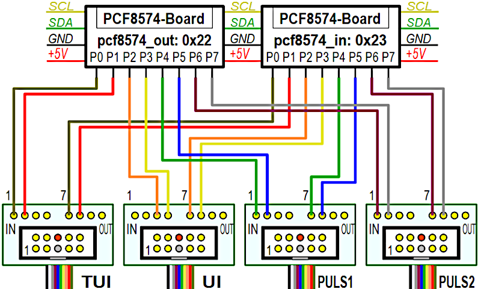

<a name="up"></a>
<table><tr><td></img></td><td>
<h1>Anpassen des Demo-Programms an eigene Bed&uuml;rfnisse</h1><b><big>Demo-Software zum Steuern von Modellbahn-Komponenten</big></b><br>  
Stand: 19.11.2026    &nbsp; &nbsp; &nbsp; &nbsp;
<a href="#TableOfContents">→ Inhaltsverzeichnis</a>&nbsp; &nbsp; &nbsp; &nbsp;
<a href="README.md">→ English version</a>
</td></tr></table>

<a name="x10"></a>   

# 1. Einleitung

Für viele Anwendungen des RCC-Systems genügt es, zwei Dateien anzupassen:  

- **`src/rcc_config.h`**: Hier werden die verwendeten Komponenten und ihre Verdrahtung festgelegt.
- **`src/rcc_demo2.text.h`**: Hier können die Informationstexte angepasst werden, die beim Programmstart angezeigt werden.

Wie diese Anpassungen vorgenommen werden, beschreibt diese Anleitung.  

Das Steuerprogramm `rcc_demo2.cpp` muss normalerweise nicht geändert werden. Wenn die Steuerung erweitert werden soll, hilft die ausführliche [technische Beschreibung der Demo-Software in `DETAILS_D.md`](/software/rcc_demo2/DETAILS_D.md).  

<a name="TableOfContents"></a>   

## Inhaltsübersicht
* [1. Einleitung](#x10)  
* [2. Die Konfigurationsdatei rcc_config.h](#x20)  
* [3. Die Textdatei dcc_demo2_text.h](#x30)  

<a name="x20"></a>   

# 2. Die Konfigurationsdatei rcc_config.h
## &Uuml;bersicht
In der Konfigurationsdatei `rcc_config.h` werden alle wesentlichen Projekteigenschaften definiert wie   
* Versionsbezeichnung des Programms (zB das Datum der letzten &Auml;nderung)   
* Informationen zum verwendeten Netzwerk (WLAN)   
* implementierte MQTT GET- und SET-Nachrichten   
* Eigenschaften des verwendeten Displays   
* ein m&ouml;glicher Offset f&uuml;r DCC-Adressen   
* die Anzahl der I²C-I/O-Expander, ihre Namen, Adressen und Startwerte   
* die Anzahl der Eisenbahnkomponenten und deren Typ, Name, DCC-Adresse, Expander-Nummer und -Pinbelegung sowie Schaltzeiten   

## Beispiel Demo-Programm "dcc_demo2"   
Die elektrische Verdrahtung der Komponenten muss bekannt sein und in der Konfigurationsdatei abgebildet werden. F&uuml;r das Demo-Programm `dcc_demo2` wird von folgender I²C-Verdrahtung ausgegangen:   
* 2x I²C-Expander mit den Namen `pcf8574_out` (7-Bit-Adresse 0x22) und `pcf8574_in` (7-Bit-Adresse 0x23)., d.h. je ein Expanderboard f&uuml;r Ausg&auml;nge und ein Expanderboard f&uuml;r Eing&auml;nge   
* DCC 61, IO-Expander Pin 0,1: Fahrstromschalter (Schaltblock TUI)   
* DCC 71, IO-Expander Pin 2,3: Fahrstromanzeige (Schaltblock UI)   
* DCC 81,82, IO-Expander Pin 4,5: Impulsanzeige 2-fach (Schaltblock PULS1)   
* DCC 91, IO-Expander Pin 6,7: Impulsanzeige Set/Reset (Schaltblock PULS2)   

Das folgende _Bild 1_ veranschaulicht nochmals diese Daten.   

   
_Bild 1: I²C-Verdrahtungsplan des Blocktesters #2_   

Das Listing zeigt die Konfigurationsdatei f&uuml;r das Demo-Programm __mit Zeilennummern__. Danach wird erkl&auml;rt, welche Zeilen angepasst werden m&uuml;ssen.   

```   
  1 |//_____rcc_config.h______________________________khartinger_____
  2 |// Configure file for ESP32 railroad DCC decoder program
  3 |// rcc_demo2
  4 |// Created by Karl Hartinger, November 14, 2024
  5 |// Changes:
  6 |// 2026-11-19 Change file name
  7 |// Released into the public domain.
  8 |
  9 |#ifndef RCC_CONFIG_H
 10 | #define RCC_CONFIG_H
 11 | #include "pre_config.h"                    // common defines
 12 | #include <Arduino.h>                       // String, int32_t
 13 | #include "src/pcf8574/D1_class_PCF8574.h"  // PCF8574
 14 | #include "src/statemachine/D1_class_Statemachine.h" // STATE_NONE
 15 |
 16 |//_______show debug information_________________________________
 17 |#define  DEBUG_99       false               // true OR false
 18 |#define  DEBUG_99_SHOW_ALL  false           // true OR false
 19 |
 20 |//_______program version________________________________________
 21 |constexpr char VERSION_99[] = "2026-11-14 rcc_demo2";
 22 |constexpr char VERSION_99_1[] = "Version 2026-11-14";
 23 |
 24 |//_______Network data___________________________________________
 25 |#define _USE_WIFI_      true
 26 |constexpr char _SSID_[] = "Raspi11";
 27 |constexpr char _PASS_[] = "12345678";
 28 |constexpr char _HOST_[] = "10.1.1.1";
 29 |constexpr char _ESP_NAME_[] = "rccdemo2";
 30 |
 31 |//_______MQTT data______________________________________________
 32 |constexpr char TOPIC_BASE[] = "rcc/demo2";
 33 |constexpr char TOPIC_GET[] = "?,help,version,mac,ip,signal,topicbase,eeprom,byname,bydcc,status";
 34 |constexpr char TOPIC_SET[] = "topicbase,wlan,eeprom0";
 35 |constexpr char TOPIC_SUB[] = "";
 36 |constexpr char TOPIC_PUB[] = "";
 37 |
 38 |//_______1.54" display data (SSD1309, 128x64 pixel, I2C)________
 39 |constexpr char SCREEN_TITLE[] = "RCC_Demo2";
 40 |constexpr int  SCREEN_LINE_MAX = 6;
 41 |constexpr int  SCREEN_LINE_LEN = 21;
 42 |constexpr int  SHOW_INFOPAGE_SEC = 20; // time to show one page
 43 |
 44 |//_______DCCex__________________________________________________
 45 |constexpr int  DCC_OFFSET = 4;
 46 |
 47 |//_______Software: Railroad commands____________________________
 48 |//.......PCF8574 lines B A to control 2way turnout (active low!)
 49 |constexpr int CMD_NONE = -1;      // no command
 50 |constexpr int CMD_BIT_A_0 = 1;    // set bit A=0 (inverted)
 51 |constexpr int CMD_BIT_A_1 = 2;    // set bit A=1 (inverted)
 52 |constexpr int CMD_BIT_BA_00 = 3;  // bits BA = 00
 53 |constexpr int CMD_BIT_BA_10 = 4;  // bits BA = 10
 54 |constexpr int CMD_BIT_BA_01 = 5;  // bits BA = 01
 55 |constexpr int CMD_BIT_BA_11 = 6;  // bits BA = 11
 56 |constexpr int CMD_BLINK = 7;      // start blinking light
 57 |constexpr int CMD_BLINK_END =8;   // stop blinking light
 58 |
 59 |//.......All properties of a railroad command...................
 60 |// command: 0=out, 1=straight, 2=curved, 3=undefined (switching)
 61 |struct strRcmd {
 62 |  int     iCmd;         // command - what to do (now)
 63 |  int     inValue;      // current input value
 64 |  bool    inValueChanged; // true=yes, value has changed
 65 |  int32_t stateToDo;    // in which state should command be executed?
 66 |  int32_t stateOffset;  // additional state offset value
 67 |  int     iCmdOffset;   // command - what to do @ offset state
 68 |};
 69 |//.......Default values for all railroad commands...............
 70 |#define RCMD_NONE       CMD_NONE,-1,STATE_NONE,STATE_NONE,CMD_NONE
 71 |
 72 |//_______Hardware: IO expander PCF8574__________________________
 73 |// Assumption: IO boards on I2C bus #1, initial value 0xFF.
 74 |// Changes can be made in file rcc_config.cpp
 75 |
 76 |// ***** CHECK this! *******************************************
 77 |#define  IOEX_NUM       2         // number of IO expander 2|4|6|8
 78 |
 79 |// *****Especially for DEMO2: **********************************
 80 |#define  IOEX_ADDRESS1  0x22      // pcf8574_out #1
 81 |#define  IOEX_ADDRESS2  0x23      // pcf8574_in  #1
 82 |
 83 |//.......Suggested addresses....................................
 84 |//#define  IOEX_ADDRESS1  0x20      // pcf8574_out #1
 85 |//#define  IOEX_ADDRESS2  0x21      // pcf8574_in  #1
 86 |#define  IOEX_ADDRESS3  0x22      // pcf8574_out #2
 87 |#define  IOEX_ADDRESS4  0x23      // pcf8574_in  #2
 88 |#define  IOEX_ADDRESS5  0x24      // pcf8574_out #3
 89 |#define  IOEX_ADDRESS6  0x25      // pcf8574_in  #3
 90 |#define  IOEX_ADDRESS7  0x26      // pcf8574_out #4
 91 |#define  IOEX_ADDRESS8  0x27      // pcf8574_in  #4
 92 |
 93 |//_______Definitions for railroad components____________________
 94 |//.......values for every railroad component....................
 95 |// e.g. turnout, uncoupler, disconnectable track, ...
 96 |constexpr int  NO_PIN = -1;       // no pin @ PCF8574 (0...7)
 97 |constexpr int  RC_TYPE_UC = 1;    // uncoupler (Entkuppler)
 98 |constexpr int  RC_TYPE_TO = 2;    // turnout (Weiche)
 99 |constexpr int  RC_TYPE_T3 = 3;    // 3way turnout (Dreiwegweiche)
100 |constexpr int  RC_TYPE_DT = 4;    // disconnectable track (Fahrstrom)
101 |constexpr int  RC_TYPE_TX = 5;    // double slip turnout/switch (Doppelkreuzungsweiche)
102 |constexpr int  RC_TYPE_DD = 6;    // double pole, double throw (2x UM)
103 |constexpr int  RC_TYPE_TUI = 7;   // Track voltage current
104 |constexpr int  RC_TYPE_P1 = 8;    // pulse 1 input (set), reset by hardware
105 |constexpr int  RC_TYPE_P2 = 9;    // pulse 2 inputs (reset, set)
106 |constexpr int  RC_TYPE_UI = 10;   // current (I)-voltage (U)-indicator
107 |constexpr int  RC_TYPE_BL = 11;   // blink light (Blinklicht)
108 |
109 |//.......All properties of a railroad component.................
110 |struct strRcomp {
111 |  int    type;          // RC_TYPE_TO, RC_TYPE_UC, RC_TYPE_DT
112 |  String name;          // short name like T1, U1, D1, W1, E1...
113 |  int    dcc;           // dcc address of the component
114 |  int    outPCF;        // aIOEx index of PCF8574 output device
115 |  int    outBitA;       // bit PCF8574 for turnout straight (Gerade)
116 |  int    outBitB;       // bit PCF8574 for turnout curved (Abzweig)
117 |  int    inPCF;         // aIOEx index of PCF8574 input device
118 |  int    inBitA;        // bit number at PCF8574 input straight=1
119 |  int    inBitB;        // bit number at PCF8574 input curved=1
120 |  int32_t msOn;         // ms on
121 |  int32_t msOff;        // ms off
122 |};
123 |
124 |// ***** CHECK this! *******************************************
125 |//_______Railroad components____________________________________
126 |/**
127 | * @brief Definition of all Railroad Components
128 | * 
129 | * Every railroad component has 11 parameters:
130 | *       type,name (max 3 char),dcc,
131 | *       pIOEx-out-index,outBitA,outBitB,
132 | *       pIOEx-in-index,inBitA,inBitB
133 | *       msOn,msOff
134 |*/
135 |// -------------------------------------------------------------
136 |/**
137 | * @brief uncoupler (Entkuppler)
138 | * Output Pin 0: start uncoupler for 1500 ms (1) or stop it (0)
139 | * Input  Pin 0: status uncoupler (1=on, 0=off)
140 | */
141 |#define  RCOMP_1   RC_TYPE_UC,"UC", 11, EX0,PIN0,NO_PIN, EX1,PIN0,NO_PIN, 1500,0
142 |
143 |// -------------------------------------------------------------
144 |/**
145 | * @brief two way turnout (Zweiwegweiche = Standardweiche)
146 | * Output Pin 1 = A: 0 = curved   (active low), 500 ms on
147 | *        Pin 2 = B: 0 = straight (active low), 500 ms on
148 | * Input  The feedback from Pin 2 and Pin 1 yields the value BA:
149 | *        BA = 1 (01) = stright, BA = 2 (10) = curved
150 | */
151 |#define  RCOMP_2   RC_TYPE_TO,"T2", 21, EX0,PIN1,PIN2,   EX1,PIN1,PIN2, 500,0
152 |
153 |// -------------------------------------------------------------
154 |/**
155 | * @brief three way turnout (Dreiwegweiche)
156 | * NOTE: TWO components must be defined for 3 pins (B is shared)
157 | * Output Pin 3|5 (A) = 0: curved (active low), 500 ms on
158 | *        Both Pin 4 (B) = 0: straight (active low), 500 ms on
159 | * Input  Pin 3 (A) = 0 turnout curved (left)
160 | *        Pin 4 (B) = 0 turnout straight
161 | *        Pin 5 (A) = 0 turnout curved (right)
162 | */
163 |#define  RCOMP_3L  RC_TYPE_T3,"T3L",31, EX0,PIN3,PIN4,   EX1,PIN3,PIN4, 500,0
164 |#define  RCOMP_3R  RC_TYPE_T3,"T3R",32, EX0,PIN5,PIN4,   EX1,PIN5,PIN4, 500,0
165 |
166 |// -------------------------------------------------------------
167 |/**
168 | * @brief disconnectable track (Fahrstrom)
169 | * Output Pin 6: 1 = on, 0 = off
170 | * Input  Pin 6: status track voltage (1 = on, 0 = off)
171 | */
172 |#define  RCOMP_4   RC_TYPE_DT,"DT", 41, EX0,PIN6,NO_PIN, EX1,PIN6,NO_PIN, 0,0
173 |
174 |// -------------------------------------------------------------
175 |/**
176 | * @brief blink light (Blinklicht)
177 | * Output Pin 7: 1 = on (500 ms), 0 = off (500 ms)
178 | * Input: none
179 | */
180 |#define  RCOMP_5   RC_TYPE_BL,"BL", 51, EX0,PIN7,NO_PIN, EX1,NO_PIN,NO_PIN, 500,500
181 |
182 |// -------------------------------------------------------------
183 |//...if you want to test TX and/or DD: replace RCOMP_2/RCOMP_4..
184 |
185 |// -------------------------------------------------------------
186 |/**
187 | * @brief double slip turnout/switch (Doppelkreuzungsweiche)
188 | * Output Pin 1 = A: 0 = curved   (active low), 500 ms on
189 | *        Pin 2 = B: 0 = straight X (active low), 500 ms on
190 | * Input  The feedback from Pin 2 and Pin 1 yields the value BA:
191 | *        BA = 1 (01) = stright X, BA = 2 (10) = curved
192 | */
193 |//#define  RCOMP_2   RC_TYPE_TX,"TX", 21, EX0,PIN1,PIN2,   EX1,PIN1,PIN2, 500,0
194 |
195 |// -------------------------------------------------------------
196 |/**
197 | * @brief double pole, double throw (2x UM)
198 |*/
199 |//#define  RCOMP_4   RC_TYPE_DD,"DD", 41, EX0,PIN6,NO_PIN, EX1,PIN6,NO_PIN, 0,0
200 |
201 |// -------------------------------------------------------------
202 |/**
203 | * @brief Track voltage (U) switch and current (I) indicator
204 | * Output Pin 0: TONn ... switch track voltage on (0) or off (1)
205 | * Input  Pin 0: RTVn ... track voltage is on (0) or off (1)
206 | *        Pin 1: RFREn .. track is free (0) or occupied (1)
207 | */
208 |#define  RCOMP_6   RC_TYPE_TUI,"TUI", 61, EX0,PIN0,NO_PIN,   EX1,PIN0,PIN1, 0,0
209 |
210 |// -------------------------------------------------------------
211 |/**
212 | * @brief voltage (U)-current (I)-indicator
213 | * No current flow means that the track is unoccupied (free).
214 | * Note: Input free: Pin=0, Output free: Pin=1 (i.e., inverted!)
215 | * Two pins and two consecutive DCC addresses are required for 
216 | * control and display:
217 | * The lower address for the current flow (or whether the track
218 | * is free), and the higher address for the track voltage or 
219 | * whether the current flow signal is correct (OK=1). 
220 | * Input:  Two expander pins A for voltage (1) and free (I=0)
221 | * Output: Two expander pins A for free (1) and OK (1)
222 |*/
223 | #define  RCOMP_7   RC_TYPE_UI,"UI1", 71, EX0,PIN2,PIN3,   EX1,PIN2,PIN3, 0,0
224 |
225 |// -------------------------------------------------------------
226 |/**
227 | * @brief pulse with 1 input (set)
228 | * The hardware automatically resets the pulse after a few milliseconds to seconds.
229 | * The block contains two separate pulse inputs.
230 | * Output: Pin 2 (A) = 0: simulate set pulse #1 by software (active low!)
231 | *         Pin 3 (B) = 0: simulate set pulse #2 by software (active low!)
232 | * Input : Pin 2 (A) = 0: pulse #1 is active (1 = no pulse)
233 | *         Pin 3 (B) = 0: pulse #2 is active (1 = no pulse)
234 | */
235 | #define  RCOMP_8a   RC_TYPE_P1,"P1", 81, EX0,PIN4,NO_PIN,   EX1,PIN4,NO_PIN, 0,0
236 | #define  RCOMP_8b   RC_TYPE_P1,"P1", 82, EX0,PIN5,NO_PIN,   EX1,PIN5,NO_PIN, 0,0
237 |
238 |// -------------------------------------------------------------
239 |/**
240 | * @brief pulse with 2 inputs (reset, set)
241 | * Output: Pin 5 (B) = 0: simulate set pulse (500 ms) by software (active low!)
242 | *         Pin 4 (A) = 0: simulate reset pulse (500 ms) by software (active low!)
243 | * Input : 
244 | */
245 | #define  RCOMP_9   RC_TYPE_P2,"P2", 91, EX0,PIN6,PIN7,   EX1,PIN6,PIN7, 500,0
246 |
247 |// ***** CHECK this! *******************************************
248 |//.......Preparing the Array of all railroad components..........
249 |#define  RCOMP_NUM  5
250 |#define  RCOMP_LIST {RCOMP_6},{RCOMP_7},{RCOMP_8a},{RCOMP_8b},{RCOMP_9}
251 |
252 |#endif
```  

## Erforderliche Anpassungen in der Datei rcc_config.h
Die folgende Tabelle erkl&auml;rt die Bedeutung der einzelnen Zeilen in der Demo-Konfigurationsdatei `rcc_config.h`. Die Spalte `Chg` (change = &auml;ndern) gibt an, ob die Zeile(n) ge&auml;ndert werden sollen oder nicht:   
 1 = unbedingt &auml;ndern bzw. anpassen   
 2 = Zeile sollte angepasst werden   
 3 = Zeile kann ge&auml;ndert werden   
 x = Zeile(n) nicht &auml;ndern   

| Zeile   | Chg | Bedeutung |   
|:-------:|:---:|-----------|   
| 21,22   |  2  | Versionsnummer/&Auml;nderungsdatum der Datei. |   
| 25      |  2  | Soll ein Netzwerk (WLAN) verwendet werden? <br> true = ja, false = nein |   
| 26 - 29 |  2  | Wenn ein Netzwerk verwendet wird: Name und Passwort des WLAN sowie IP des Rechners, auf dem der MQTT-Broker l&auml;uft. |   
| 32      | __1__ | Das Basis-Topic, unter dem der Mikrocontroller MQTT-Nachrichten sendet oder empf&auml;ngt. |   
| 33      |  x  | Alle GET-Nachrichten, auf die der Mikrocontroller antwortet. |   
| 34      |  x  | Alle SET-Nachrichten, auf die der Mikrocontroller reagiert. |   
| 39      |  2  | Titel auf der OLED-Anzeige. |   
| 42      |  3  | Anzahl Sekunden, wie lange jede Info-Seite beim Start angezeigt werden soll (zB 20 Sekunden). |   
| 45      |  3  | Offset der DCC-Adressen, je nach DCC-Sendeger&auml;t (Wert kann 4 oder 0 sein). |   
| 77      | __1__ | Anzahl der eingesetzten I²C-I/O-Expander-Boards PCF8574 (2, 4, 6 oder 8).   |   
| 80 - 85 |  2  | Adresse der IO-Expander 1 und 2. Standard ist 0x20 und 0x21, bei `rcc_demo2` wird aber 0x22 und 0x23 verwendet. Entweder Zeile 80+81 oder 84+85 auskommentieren. |  
| 124 - 244 |  x  |  Beispiel-Definitionen von Eisenbahnkomponenten. Der Aufbau jeder Zeile entspricht der Struktur von Zeile 129 bis 132. |  
| 247 - 251 | __1__ | Definitionen der aktuellen Eisenbahnkomponenten. Die Zeilen können Kopien der Beispieldefinitionen sein, allerdings **müssen** die Expander- und Pin-Nummern an die Hardware angepasst werden! |  
| 254     | __1__ | Anzahl der Eisenbahn-Komponenten. |   
| 255     | __1__ | Aufzählung der Eisenbahn-Komponenten. |   

<a name="x30"></a>   

# 3. Die Textdatei dcc_demo2_text.h
Die Datei `dcc_demo2_text.h` enth&auml;lt Konstante sowie Texte in deutscher und englischer Sprache für die OLED-Anzeige.   
Anzupassen sind die Texte, die sich in den Zeilen 66 bis 83 (Deutsch) und 133 bis 150 (Englisch) befinden. Dabei werden jeweils 5 Zeilen f&uuml;r 20 Sekunden (`SHOW_INFOPAGE_SEC`) angezeigt.   
Die Texte k&ouml;nnen auch gel&ouml;scht werden, dann ist die Konstante `INFOLINES_NUM` auf 0 zu setzen:   
```   
#define  INFOLINES_NUM     0
```   

[Zum Seitenanfang](#up)
