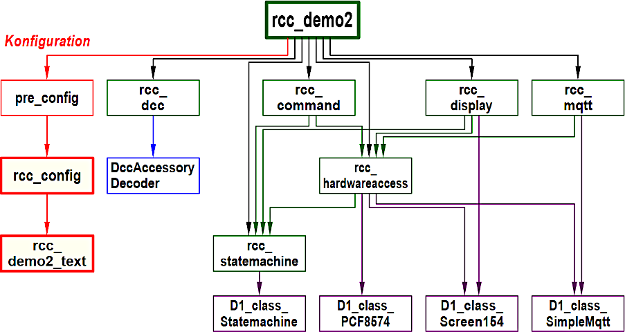

<a name="up"></a>
<table><tr><td></img></td><td>
<h1>Das Demo-Programm rcc_demo2 im Detail</h1><b><big>Details zur Demo-Software zum Steuern von Modellbahn-Komponenten</big></b><br>  
Stand: 19.11.2026    &nbsp; &nbsp; &nbsp; &nbsp;
<a href="#TableOfContents">→ Inhaltsverzeichnis</a>&nbsp; &nbsp; &nbsp; &nbsp;
<a href="README.md">→ English version</a>
</td></tr></table>

<a name="x10"></a>   

# 1. Übersicht über `rcc_demo2`
Der Quellcode des Demo-Programms `rcc_demo2` ist modular aufgebaut und besteht aus vielen Dateien:  

  

__*Beachte*__: Bei einem Standard-Projekt ohne spezielle Features müssen lediglich die beiden Konfigurationsdateien `rcc_config.h` und `rcc_demo2_text.h` angepasst werden. 

### Die Verzeichnisse und Dateien im Detail  
| Datei | Inhalt |  
| ----- | ------ |  
| `src/rcc_demo2.cpp` | Hauptprogramm mit `setup()` und `loop()` |  
| `src/rcc_demo2_text.cpp` | Texte in Deutsch und Englisch wie Startbildschirmtexte etc. |  
| `src/rcc_config.h` | Definitionen und Konstante wie DEBUG, VERSION, Netzwerkdaten, MQTT-Befehle, Expander-Adressen, Railroad-Komponenten, ... |  
| `src/pre_config.h` | Expander-Namen und Pin-Namen |  
| `src/src/rcc_config.cpp` | Objekte zu den Deklarationen in `rcc_config.h` |  
| `src/src/rcc_command` (.ccp\|.h) | Funktionen für Kommandos zu den Railroad-Komponenten |  
| `src/src/rcc_dcc` (.ccp\|.h) | Funktion zum Empfang von DCC-Nachrichten. Diese basiert auf der externen Bibliothek `lib_deps = https://github.com/enginorama/DccAccessoryDecoder` (siehe Datei `platformio.ini`). |  
| `src/src/rcc_display` (.ccp\|.h) | Funktionen zur Darstellung von Information auf der OLED-Anzeige |  
| `src/src/rcc_hardwareaccess` (.ccp\|.h) | Funktionen für den Hardware-Zugriff |  
| `src/src/rcc_mqtt` (.ccp\|.h) | Funktionen für MQTT-Nachrichten und JSON |  
| `src/src/rcc_statemachine` (.ccp\|.h) | Konstante und Objekt für die State-Maschine |  
| `src/src/cppsrc` (.ccp\|.h) | Zeichendateien (Grafikbibliothek) |  
| `src/src/csrc` (.ccp\|.h) | Zeichendateien (Grafikbibliothek) |  
| `src/src/pcf8574` (.ccp\|.h) | Klasse PCF8574 |  
| `src/src/screen154` (.ccp\|.h) | Klasse Screen154 |  
| `src/src/simplemqtt` (.ccp\|.h) | Klasse SimpleMqtt und PubSubClient |  
| `src/src/statemachine` (.ccp\|.h) | Klasse Statemachine |  

<a name="x05"></a>   
<a name="TableOfContents"></a>   

## Inhaltsübersicht
* [1. Übersicht über rcc_demo2](#x10)  
* [2. Das Hauptprogramm rcc_demo2.cpp](#x20)  
* [3. Konfiguration](#x30)  
* [4. Statemachine](#x40)  
* [5. DCC-Befehle](#x50)  
* [6. RCC-Kommandos](#x60)  
* [7. Hardware-Zugriff](#x70)  
* [8. OLED-Anzeige](#x80)  
* [9. MQTT-Befehle](#x90)  
* [10. Beispiel: Ergänzung eines Schaltblocks](#x100)  

<a name="x20"></a>   
<a name="x21"></a>   

# 2. Das Hauptprogramm rcc_demo2.cpp
# 2.1 Funktion
Das Hauptprogramm `rcc_demo2.cpp` definiert den Prozessortyp (ESP32), die Anzeigesprache (Deutsch) und bindet alle Header-Dateien und extern definierte Objekte (`screen_`, `stm`, `lastDCC`) ein. Es enthält die Standard-Funktionen `setup()` und `loop()`.

<a name="x22"></a>   

## 2.2 Funktion setup()

<a name="x23"></a>   

## 2.3 Funktion loop()


<a name="x30"></a>   
<a name="x31"></a>   

# 3. Konfiguration
Alle Definitionen, Konstanten, globale Variable und Objekte, die das Programm ben&ouml;tigt, werden entweder direkt in der cpp-Datei oder in einer Konfigurationsdatei definiert. Die Verteilung ist so gew&auml;hlt, dass projektspezifische Daten in der Konfigurationsdatei `rcc_config.h` stehen.   
Die Konfigurationsdatei enth&auml;lt folgende Abschnitte:   
* Netzwerk- und MQTT-Daten   
* Display-Daten   
* DCCex-Daten   
* IO-Expander PCF8574-Daten   
* Definition f&uuml;r Eisenbahn-Komponenten   
* die Eisenbahn-Komponenten selbst   
   
Weitere Infos zur Konfiguration stehen in **[CUSTOMIZE_D.md](./CUSTOMIZE_D.md):** Anpassung der Software an eigene Anforderungen   

<a name="x40"></a>   
<a name="x41"></a>   

# 4. Statemachine
## 4.1 Funktion
Das Timing des Programms wird mit einer Statemachine realisiert. Wird die maximale Dauer eines States überschritten, so wird diese Zeit in den nachfolgenden States aufgeholt (aber nicht mehr als maximal 100 kurze States).   

<a name="x42"></a>   

## 4.2 Header-Datei
In der Header-Datei `rcc_statemachine.h` wird das zeitliche Verhalten des Programms festgelegt:  
```
 8 |//------- Duration of intervals in milliseconds ----------------
 9 |constexpr uint32_t STATE_TICK_MS      = 20;      // state delay in ms
10 |constexpr uint32_t RESET_DELAY_MS     = 1000;    // press button 1 s
11 |constexpr uint32_t SCREEN_REFRESH_MS  = 5200;    // refresh screen
12 |constexpr uint32_t SHOW_SCREEN_MIN_MS = 1500;
13 |constexpr uint32_t BLINK_MS           = 500;     // 0.5 s
14 |//------- Duration of intervals in state steps ---------------------------
15 |constexpr uint32_t STATE_MAX          = 3600000 / STATE_TICK_MS; // 1h
16 |constexpr uint32_t STATES_BEFORE_RESET = RESET_DELAY_MS / STATE_TICK_MS;
17 |constexpr uint32_t STATES_SCREEN_REFRESH = SCREEN_REFRESH_MS / STATE_TICK_MS;
18 |constexpr uint32_t STATES_SHOW_SCREEN_MIN = SHOW_SCREEN_MIN_MS / STATE_TICK_MS;
19 |constexpr uint32_t STATES_BLINK = BLINK_MS / STATE_TICK_MS;

```
* _Zeile  9_: Dauer eines States in Millisekunden.  
* _Zeile 10_: Dauer, wie lange der Taster (IO 19 = D6) für einen Programm-Reset gedrückt werden muss (in Millisekunden).  
* _Zeile 11_: Dauer zwischen zwei Display-Refreshs (in Millisekunden), wenn es keine Zustandsänderungen gibt. Dies ist für die Lebensdauer von OLEDs wichtig.  
* _Zeile 12_: Mindestdauer, wie lange ein Bildschirm angezeigt wird, bevor auf einen anderen umgeschaltet wird (falls es eine Zustandsänderung bei einem Schaltblock gegeben hat).
* _Zeile 13_: Vorgabewert für Blinklichter.  
* _Zeile 15_: Maximale Statenummer, bis zu der gezählt wird. Bei einer Stunde Zykluszeit und einer State-Zeit von 20 ms ergibt sich ein Wert von 180000.  
* _Zeile 16 bis 19_: Alle Zeiten als State-Werte für die Statemachine.  

<a name="x43"></a>   

## 4.3 cpp-Datei
Die Datei `rcc_statemachine.cpp` definiert lediglich ein Objekt der Klasse `Statemachine`:  
```
Statemachine stm(STATE_MAX, STATE_TICK_MS);  // 1 .. 180000
```

<a name="x44"></a>   

## 4.4 Hilfsklasse `Statemachine`
Im Unterverzeichnis `statemachine` wird eine Klasse `Statemachine` definiert. Diese enthält alle Methoden, die für eine Statemachine erforderlich sind wie zum Beispiel  
|  |  |
|------------------|-----|  
| `Statemachine()` | Konstruktor |  
| `loopBegin()`    | Aufruf am Beginn der loop()-Funktion. Liefert die Nummer des aktuellen States. |  
| `loopEnd()`      | Aufruf am Ende der loop()-Funktion. Erhöht den State-Zähler und liefert die Dauer des aktuellen States. |  
| `getState()`     | Liefert die Nummer des aktuellen States. |  
| `add()`          | Addiert eine Anzahl States zur aktuellen Statezahl und gibt diesen Wert zurück. Die Methode ändert NICHT den Zählerstand! |  
| `diff()`         | Dient zur Berechnung der State-Differenz zwischen dem Statezähler und dem angegebenen Wert. |  

<a name="x50"></a>   
<a name="x51"></a>   

# 5. DCC-Befehle

## 5.1 Funktion
Je nach verwendeten Komponenten kann es sein, dass DCC-Adressen unterschiedlich dekodiert werden. Dieser Offset kann mit der Konstanten `DCC_OFFSET` angepasst werden, wobei der Wert &uuml;blicherweise entweder 4 oder 0 sein kann.   

<a name="x52"></a>   

## 5.2 Header-Datei
Die Header-Datei `rcc_dcc.h` definiert eine Struktur für DCC-Kommandos  
```   
struct DccCommand
{
    uint16_t address = 0;  ///< DCC address; 0 means no address assigned.
    int value = -1;        ///< Command value: -1 = invalid, 0 = OFF, 1 = ON.
};
```   
und deklariert die Callback-Funktion zum Empfang von DCC-Nachrichten:  
`void onAccessoryPacket(unsigned int linearDecoderAddress, bool enabled);`  

<a name="x53"></a>   

## 5.3 cpp-Datei
Die Datei `rcc_dcc.cpp` erzeugt ein Objekt zur Aufnahme der letzten DCC-Nachricht (Adresse, Wert)  
`DccCommand lastDcc;`  
und definiert die DCC-Callback-Funktion.
```   
21 |void onAccessoryPacket(unsigned int linearDecoderAddress, bool enabled) {
22 | digitalWrite(BUILTIN_LED, enabled ? 1 : 0);
23 | lastDcc.address=(int)linearDecoderAddress + DCC_OFFSET;
24 | lastDcc.value=enabled ? 1 : 0;
25 | //------is it a DCC address for this module?-------------------
26 | for(int i=0; i<RCOMP_NUM; i++) {
27 |  if(aRcomp[i].dcc==lastDcc.address) {
28 |   //----railroad component found-------------------------------
29 |   setRcmd(i, lastDcc.value, "");
30 |  }
31 | }
32 |}
```   

_Zeile 22_: Zur Kontrolle: Anzeige des empfangenen DCC-Wertes durch die eingebaute LED des ESP32-Boards.  
_Zeile 23_: Adresse der Nachricht merken  
_Zeile 24_: Wert der Nachricht merken  
_Zeile 26 bis 31_: Überprüfung, ob die Nachricht zu einer Adresse einer Komponente passt. Wenn ja, wird ein RCC-Befehl erzeugt.  

<a name="x54"></a>   

## 5.4 Einbinden der DCC-Callback-Funktion
Damit DCC-Nachrichten empfangen werden können muss eine externe Bibliothek eingebunden werden. Dies geschieht in `platformio.ini`:  
```   
[env:wemos_d1_mini32]
platform = espressif32
board = wemos_d1_mini32
framework = arduino
monitor_speed = 115200
lib_deps =
  bblanchon/ArduinoJson@^6.21.1
  https://github.com/enginorama/DccAccessoryDecoder
```   

<a name="x60"></a>   
<a name="x61"></a>   

# 6. RCC-Kommandos
## 6.1 Funktion

<a name="x62"></a>   

## 6.2 Header-Datei

<a name="x63"></a>   

## 6.3 cpp-Datei

<a name="x70"></a>   

# 7. Hardware-Zugriff

<a name="x80"></a>   

# 8. OLED-Anzeige

<a name="x90"></a>   

# 9. MQTT-Befehle

<a name="x100"></a>   

# 10. Beispiel: Ergänzung eines Schaltblocks

Hier die Schritte zum Einbau einer neuen Komponente am Beispiel Pulserkennung mit zwei Eingängen (set, reset).   

## 1. Konfiguration anpassen `rcc_config.h`
* Version, `_ESP_NAME_`, `TOPIC_BASE[]` anpassen.
* IO-Expander-Zahl erhöhen  
`#define  IOEX_NUM       4         // number of IO expander 2|4|6|8`
* __Typ des neuen Blocks definieren__  
`constexpr int  RC_TYPE_P2 = 7;    // pulse 2 inputs (reset, set)`
* Hardware-Komponente definieren, zB  
```
// ------pulse with 2 inputs (reset, set)-----------------------
// Two expander pins B | A for set | reset (active low!)
// Pulse duration: 200 ms
#define  RCOMP_6        RC_TYPE_P2,"P2", 61, EX2,PIN0,PIN1,   EX3,PIN0,PIN1, 200,0
```
* Komponenten-Array vorbereiten (zB Zweiwegweiche + Pulserkennung)  
```
//.......Preparing the Array of all railroad components..........
#define  RCOMP_NUM  2
#define  RCOMP_LIST {RCOMP_2},{RCOMP_6}
```

## 2. Texte definieren `rcc_demo2_text.h`
### 2.1 Text-Konstante
Deutsche Texte   
```  
  #define T_TRACK_OCC        "Gleis besetzt"
  #define T_TRACK_FRE        "Gleis frei"
  #define T_TRACK__0V        "Keine Fahrspannung"
  #define T_TRACK_00V        "Keine Fahrspannung"
```  

Englische Texte
```  
  #define T_TRACK_OCC        "track occupied"
  #define T_TRACK_FRE        "track free"
  #define T_TRACK__0V        "no voltage"
  #define T_TRACK_00V        "no voltage"
```  

Status Definitionen als String-Nummern:  
```
 constexpr char T1_TRACK_OCC[] = "0";
 constexpr char T1_TRACK_FRE[] = "1";
 constexpr char T1_TRACK__0V[] = "2";
 constexpr char T1_TRACK_00V[] = "3";
```


### 2.2 Infotext anpassen
Deutsch   
```  
  #define  INFOLINES_NUM     10
  #define  INFOLINES { \
  "Test von RCC-     1/2", \
  "Schaltbloecken mit   ", \
  "DCC - MQTT - Hand    ", \
  VERSION_99_1, \
  " Weiter: Taste IO19  ", \
  "DCC 21 2-Weg-Weiche  ", \
  "DCC 61 Puls2         ",\
  "Es folgt: IO-Expander", \
  " und Wifi-Suche      ", \
  " Weiter: Taste IO19  ", \
  }
```  

Englisch   
```  
  #define  INFOLINES_NUM     10
  #define  INFOLINES { \
   "Test of railway      ", \
   "switch blocks by     ", \
   "DCC - MQTT - Hand    ", \
   VERSION_99_1, \
   " Next: Button IO19   ", \
   "DCC 21 2-Way-Turnout ", \
   "DCC 61 Puls2         ", \
   "Next up: IO-Expander ", \
   " and Wifi search     ", \
   " Next: Button IO19   ", \
  }
```  

## 3. P2-Befehl einbauen `rcc_command.cpp`
```  
 if(aRcomp[iRcomp].type==RC_TYPE_P2) {
  //...it is a pulse 2 command (2 bits, 2 cmd)..................
  if(iCmdValue==0) { // 0 = reset = LED green . . . . . . . . . 
   aRcmd[iRcomp].stateToDo=STATE_NOW;
   aRcmd[iRcomp].iCmd=CMD_BIT_BA_10;             //  reset
   aRcmd[iRcomp].stateOffset==aRcomp[iRcomp].msOn/static_cast<int32_t>(STATE_TICK_MS);
   if(aRcmd[iRcomp].stateOffset<1) aRcmd[iRcomp].stateOffset=1; // after some time
   aRcmd[iRcomp].iCmdOffset=CMD_BIT_BA_11;     // ready for next pulse
   return sReturn+String(" received");
  } else 
  {
   if(iCmdValue==1) { // 1 = set = LED yellow . . . . . . . . . 
    aRcmd[iRcomp].stateToDo=STATE_NOW;
    aRcmd[iRcomp].iCmd=CMD_BIT_BA_01;            // set
    aRcmd[iRcomp].stateOffset==aRcomp[iRcomp].msOn/static_cast<int32_t>(STATE_TICK_MS);
   if(aRcmd[iRcomp].stateOffset<1) aRcmd[iRcomp].stateOffset=1; // after some time
    aRcmd[iRcomp].iCmdOffset=CMD_BIT_BA_11;    // ready for next pulse
    return sReturn+String(" received");
   }
  }
 } // END OF it is a turnout command (2 bits, 2cmds)............
```  

## 4. Textgrafik-Symbol `rcc_display.cpp`
```
  case RC_TYPE_P2: // -------pulse 2 inputs (reset, set)--------
   switch(iValue) { 
    case 0: return "OCC "; // "=0= " BA=00
    case 1: return "FRE "; // "=1= " BA=01
    case 2: return " 0V "; // "=2= " BA=10
    case 3: return "00V "; // "=3= " BA=11
    default: return ERR;    // ?? impossible
   } // END OF switch(iValue)
   break;
```

## 5. GET-Command `rcc_mqtt.cpp`
In der Funktion `getValueForComp(...)`   
```  
 if(Rcomp_.type==RC_TYPE_P2) {
  switch(Rcmd_.inValue) {
   case 0:  return byName ? T_TRACK_OCC : T1_TRACK_OCC; // BA=00
   case 1:  return byName ? T_TRACK_FRE : T1_TRACK_FRE; // BA=01
   case 2:  return byName ? T_TRACK__0V : T1_TRACK__0V; // BA=10
   case 3:  return byName ? T_TRACK_00V : T1_TRACK_00V; // BA=11
   default: return byName ? T_UNKNOWN : T1_UNKNOWN; // ?? impossible
  }
 }
```  

## 5. SET-Command `rcc_mqtt.cpp`
In der Funktion `simpleSet(...)`   
```  
 { //.......NOT a turnout command..............................
    if(aRcomp[i].type==RC_TYPE_P2)
    { //......specifically for command type PULSE 2.............
      if(sPayload=="0" || sPayload == "rst" || sPayload == "reset"
         || sPayload == "fre" || sPayload == "green") iCmdValue=0;
      if(sPayload=="1" || sPayload == "set"
         || sPayload == "occ" || sPayload == "yellow") iCmdValue=1;
    }
    else
    { //......for all other command types.......................
     if(sPayload=="0") iCmdValue=0;
     if(sPayload=="1") iCmdValue=1;
    }
```  


[Zum Seitenanfang](#up)
