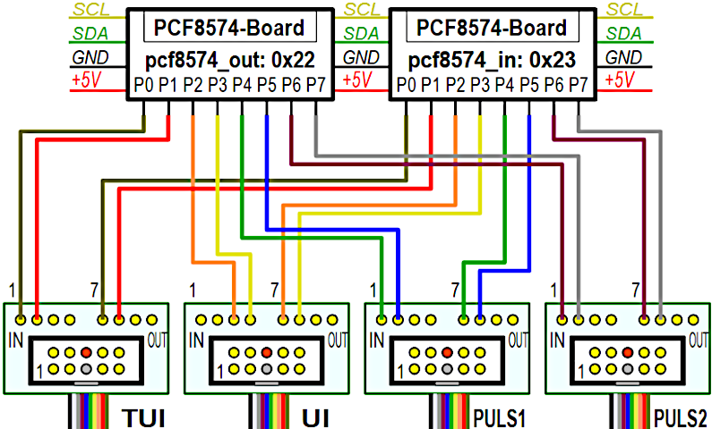

<table><tr><td></img></td><td>
<h1>RCC Demo-Software Version 2</h1><b><big>Überblick über die Demo-Software zum Steuern von Modellbahn-Komponenten</big></b>   
Stand: 19.11.2026    &nbsp; &nbsp; &nbsp; &nbsp;
<a href="#TableOfContents">→ Inhaltsverzeichnis</a>&nbsp; &nbsp; &nbsp; &nbsp;
<a href="README.md">→ English version</a>
</td></tr></table>

   

# 1. Einführung
Jedes Modellbahn-Modul besitzt einen eigenen **ESP32-Mikrocontroller** als zentrale Steuereinheit. Die **RCC-Demo-Software** bildet die Basis für diese Steuerung und lässt sich leicht an eigene Anforderungen anpassen.

Die Software `rcc_demo2` kann direkt mit der Hardware [Blocktester2](https://github.com/khartinger/RCC5V/blob/main/examples/blocktester2/LIESMICH.md) verwendet werden.

Diese Datei gibt einen Überblick über die RCC-Demo-Software.  
Weitere Informationen:  
- **[CUSTOMIZE_D.md](./CUSTOMIZE_D.md):** Anpassung der Software an eigene Anforderungen
- **[DETAILS_D.md](./DETAILS_D.md):** Technische Beschreibung der Software

   

## Inhaltsübersicht
* [1. Einführung](#x10)  
* [2. Kenntnisse über die Hardware](#x20)  
* [3. Software-Überblick](#x30)  

## Unterstützte Steuerblöcke

Folgende Steuerblöcke können mit der Demo-Software angesteuert werden:  
1. Entkuppler  
2. Zweiwegweiche (mit Endabschaltung)  
3. Dreiwegweiche (mit Endabschaltung)  
4. Fahrstrom-Schalter  
5. Blinklicht  
6. Fahrstrom-Schalter mit Fahrstromerkennung  
7. Gleis-Spannung und Gleisstrom-Anzeige (UI)  
8. Pulserkennung, zweifach  
9. Pulserkennung mit zwei Eingängen (set, reset)  
10. Doppelkreuzungsweiche  

Zur Konfiguration der Software sind Informationen zur Verdrahtung der Hardware erforderlich.  

   

# 2. Kenntnisse über die Hardware
Die Ansteuerung von Schaltblöcken durch den ESP32 erfolgt über einen I²C-Bus und I²C-PCF8574-I/O-Expander-Boards. Die Anzahl der Boards ist üblicherweise eine gerade Zahl, da immer  
* ein Board zur **Ansteuerung** der Komponenten (I2C-Adresse 0x20, IO-Expander #0) und  
* ein Board f&uuml;r die **R&uuml;ckmeldesignale** (I2C-Adresse 0x21, IO-Expander #1)  
verwendet wird.  

Die IO-Pins zur Ansteuerung und zur R&uuml;ckmeldung werden normalerweise auf die gleichen Pin-Nummern verdrahtet.  

Für die Software ist die Kenntnis der **Verdrahtung  zwischen Schaltbl&ouml;cken und I²C-I/O-Expandern** unbedingt erforderlich.  

## Beispiel Demo-Software 2
1. DCC 61, IO-Expander Pin 0,1: Fahrstromschalter (Schaltblock TUI)   
2. DCC 71, IO-Expander Pin 2,3: Fahrstromanzeige (Schaltblock UI)   
3. DCC 81,82, IO-Expander Pin 4,5: Impulsanzeige 2-fach (Schaltblock PULS1)   
4. DCC 91, IO-Expander Pin 6,7: Impulsanzeige Set/Reset (Schaltblock PULS2)   

   
_Bild 1: I²C-Verdrahtungsplan des Blocktesters #2_   

# 3. Software-Überblick

## Funktionen der Software
* Ansteuerung von Schaltblöcken.  
* Anzeige des Schaltzustands der Komponenten auf einem 1,54"-OLED-Display.  
* Mit dem Taster am Pin IO19 (D6) kann man die einzelnen Seiten der Informationsanzeige oder das Suchen nach dem WLAN überspringen.  
* Dr&uuml;ckt man w&auml;hrend des Programmlaufs den Taster an IO19 f&uuml;r mehr als eine Sekunde, wird ein Reset ausgel&ouml;st. Dies kann zB dazu verwendet werden, um beim erneuten Hochfahren das WLAN zu aktivieren.  
* Empfang von DCC-Befehlen.  
* Empfang und Senden von MQTT-Nachrichten.  

Alle projektspezifischen Daten, wie WLAN-Zugang, MQTT-Befehle und Hardware-Eigenschaften, sind in einer Konfigurationsdatei `rcc_config.h` gespeichert.   

## Entwicklungsumgebung
Das Programm wird mit Visual Studio Code (VSC) und PlatformIO erstellt.  
Nach dem Kompilieren in VSC wird das Programm mit VSC auf den ESP32 übertragen.   

## Konfigurationsdatei
Alle Definitionen, Konstanten, globale Variable und Objekte, die das Programm ben&ouml;tigt, werden entweder direkt in der cpp-Datei oder in einer Konfigurationsdatei definiert. Die Verteilung ist so gew&auml;hlt, dass projektspezifische Daten in der Konfigurationsdatei `rcc_config.h` stehen.   
Die Konfigurationsdatei enth&auml;lt folgende Abschnitte:   
* Netzwerk- und MQTT-Daten   
* Display-Daten   
* DCCex-Daten   
* IO-Expander PCF8574-Daten   
* Definition f&uuml;r Eisenbahn-Komponenten   
* die Eisenbahn-Komponenten selbst   
   
Weitere Infos zur Konfiguration stehen in **[CUSTOMIZE_D.md](./CUSTOMIZE_D.md):** Anpassung der Software an eigene Anforderungen   

## Programmversion
Bei jeder &Auml;nderung am Programm sollte die Programmversion in der Konfigurationsdatei angepasst werden. `VERSION_99` sollte das Datum und den Dateinamen enthalten, `VERSION_99_1` den Text "Version" und das Datum.   
Der Inhalt von `VERSION_99` wird als Antwort auf eine MQTT-Nachricht   
`mosquitto_pub -h 10.1.1.1 -t rcc/demo2/get -m version`   
angezeigt.   
Der Inhalt von `VERSION_99_1` wird beim Start f&uuml;r eine Sekunde in der letzten Zeile des Displays angezeigt und sollte nicht l&auml;nger als 21 Zeichen (`SCREEN_LINE_LEN`) sein.   

## Netzwerk- und MQTT-Daten
Die Definition von `_USE_WIFI_` legt grunds&auml;tzlich fest, ob WLAN und MQTT verwendet werden sollen (`true` = ja). Die Definitionen von `_SSID_`, `_PASS_` und `_HOST_` stellen die Netzwerkdaten zur Verf&uuml;gung und m&uuml;ssen an das eigene Netzwerk angepasst werden:   
| Konstante  | Zweck                                                        |   
|------------|--------------------------------------------------------------|   
| `_SSID_`   | Name des Netzwerks, in das eingew&auml;hlt werden soll.           |   
| `_PASS_`   | Passwort des Netzwerks, in das eingew&auml;hlt werden soll.       |   
| `_HOST_`   | Name des Servers (oder IP-Adresse), bei dem eingew&auml;hlt werden soll.  |   

&nbsp;   
`TOPIC_BASE` ist das Basis-Topic f&uuml;r alle MQTT-Nachrichten an das Programm. Wird diese durch eine `set/topicbase`-Nachricht ge&auml;ndert, so wird immer das ge&auml;nderte Basis-Topic verwendet, da dieses dauerhaft im EEPROM gespeichert wird.   
Beim Start des ESP wird eine Nachricht mit dem Topic `info/start/mqtt` gesendet, das das verwendete Basis-Topic enth&auml;lt:   
`info/start/mqtt {"topicbase":"modul1","IP":"10.1.1.185"}`   
Weiters wird das Basis-Topic in der 3. Zeile des Displays angezeigt.   

Bedeutung der weiteren Definitionen:   
| Konstante  | Zweck                                                        |   
|------------|--------------------------------------------------------------|   
| `TOPIC_GET`  | Alle m&ouml;glichen get-Anfragen (durch Beistriche getrennt).  |   
| `TOPIC_SET`  | Alle m&ouml;glichen get-Anfragen (durch Beistriche getrennt).  |   
| `TOPIC_SUB`  | Topics, die ebenfalls empfangen werden sollen (ohne Ber&uuml;cksichtigung des Basis-Topics).  |   
| `TOPIC_PUB`  | Topics unter denen publiziert werden soll (ohne Ber&uuml;cksichtigung des Basis-Topics).  |   

## Hardware-Pins
Die Pins f&uuml;r den DCC-Eingang (18 = D5) und den Taster (19 = D6) werden in der cpp-Datei definiert und k&ouml;nnen - falls erforderlich - dort ge&auml;ndert werden.   

## Anzeige auf der seriellen Schnittstelle
Ist der Debug-Modus eingeschaltet (`#define DEBUG_99 true`) wird im seriellen Monitor der Zustand jedes States angezeigt:   
* state Nummer   
* Zeitdauer f&uuml;r die Arbeiten in diesem State    
Zus&auml;tzlich zu diesen Informationen werden weitere Meldungen ausgeben, falls sie auftreten:   
* Ankommende DCC-Befehle   
* Freigabe der Weichensteuerung (beide Pins wieder auf 1)   

## Statemachine
Das Timing des Programms wird mit einer Statemachine realisiert. Wird die maximale Dauer eines States überschritten, so wird diese Zeit in den nachfolgenden States aufgeholt (aber nicht mehr als maximal 100 kurze States).   
In der cpp-Datei wird f&uuml;r die State-Maschine eine Z&auml;hlschleifenzeit von einer Stunde mit 20 ms pro Schritt festgelegt und kann bei Bedarf auch ge&auml;ndert werden.   

## OLED-Display
Die Ausgabe auf das Display erfolgt mit der Bibliothek [u8g2](https://github.com/olikraus/u8g2). Aufbauend auf diese Software ist die Klasse `Screen154` f&uuml;r eine Textausgabe in Zeilen zust&auml;ndig, sodass man sich um die Pixeladdressierung nicht k&uuml;mmern muss. Es wird der Bildschirm `screen15` verwendet, der einen Titel und 5 weitere Textzeilen zur Verf&uuml;gung stellt.   
In der Konfigurationsdatei werden der Titel (`SCREEN_TITLE`), die Anzahl der Zeilen (`SCREEN_LINE_MAX`) und der Zeichen pro Zeile (`SCREEN_LINE_LEN`) definiert.   

## DCC und DCCex Eigenschaften
Je nach verwendeten Komponenten kann es sein, dass DCC-Adressen unterschiedlich dekodiert werden. Dieser Offset kann mit der Konstanten `DCC_OFFSET` angepasst werden, wobei der Wert &uuml;blicherweise entweder 4 oder 0 sein kann.   

## PCF8574 Boards
Der Zugriff auf die I²C-Erweiterungsboards mit PCF8574 erfolgt mit Hilfe der Klasse `PCF8574`. F&uuml;r jedes verwendete Board muss in der Konfiguratinosdatei ein Objekt angelegt werden, dem im Konstruktor die I²C-Adresse &uuml;bergeben wird. Die einzelnen Objekte werden dann in einem Feld `*pIOEX[]` abgelegt, damit man sie - unabh&auml;ngig vom Namen - per Index durchlaufen kann.   
Die Anzahl der Boards muss extra mit `#define  IOEX_NUM       2` definiert werden. (Im Beispiel werden 2 Boards verwendet.)   

## Eisenbahnkomponenten
Die Eigenschaften jeder Eisenbahnkomponente (Weiche, Entkuppler, abschaltbares Gleis) werden als Struktur `strRcomp` definiert. F&uuml;r jede Komponente werden die Werte in einer `#define`-Anweisung festgelegt. Alle Komponenten werden in einem Feld `aRcomp[]` abgelegt.   
Die Anzahl der Komponenten muss extra mit `#define  RCOMP_NUM      xx` definiert werden.  

[Zum Seitenanfang](#up)
